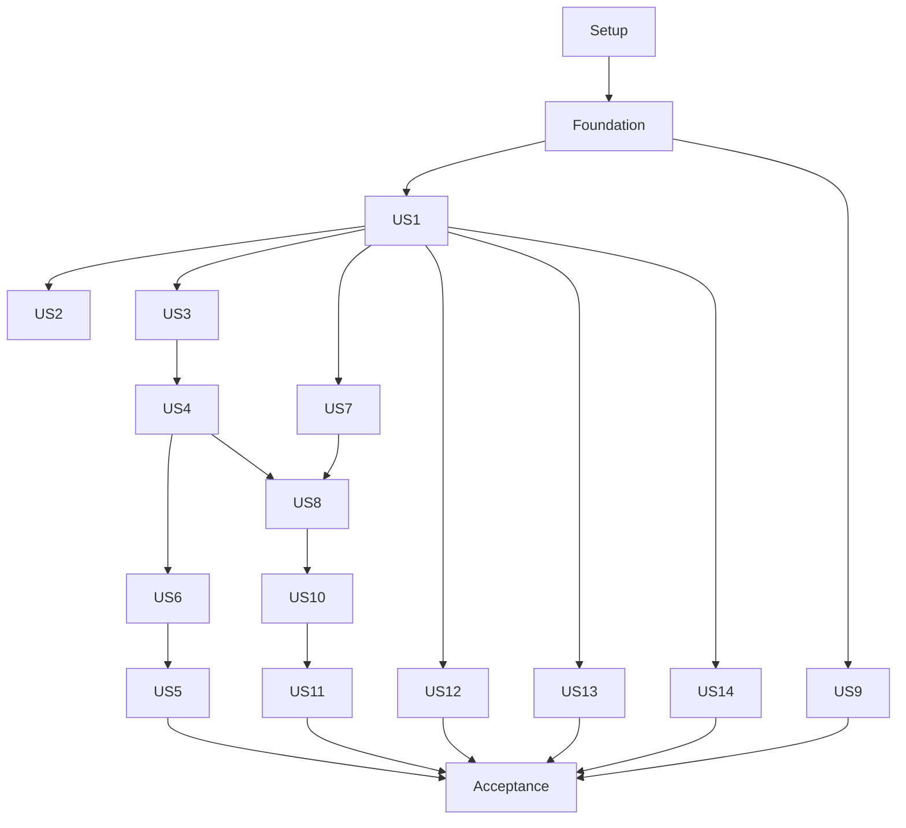

# Tasks: municipal e-Service

**Input**: [plan.md](plan.md), [spec.md](spec.md), [research.md](research.md), [data-model.md](data-model.md), [contracts/](interfaces.md).
**Status**: T001–T020 completed for the foundation/auth increments. T021–T078 remain pending; full canonical/mutation evidence remains pending.
**Tests**: Explicitly required by the assignment. Write the named source acceptance assertions before implementation; do not weaken them to make mutants pass.
**Paths**: Relative to week2_student root; application lives in web/. USn maps to original IDs in spec.md.
**[P]**: Only disjoint-file authoring after prerequisites. It never authorizes parallel acceptance execution on the shared database. Shared schema/router/CaseDetail/fixtures have one integration owner and sequential edits.

## Phase 1: Setup (Shared Infrastructure)

**Goal**: Create only the web/ implementation boundary and reproducible package/test commands.
**Dependencies**: None

- [x] T001 Bootstrap TypeScript strict, Next.js 16 and Node 24 in `web/package.json`, `web/tsconfig.json`, `web/next.config.ts`; verify compatible PDF/XLSX/QR dependencies and pin `web/package-lock.json`. Define every package script in quickstart.md. Import `specs/001-municipal-eservice/design-tokens.css` as `web/src/styles/tokens.css` in the root layout; retain JSON/CSS parity with `design-tokens.json`. Install selected C assets from `design-assets.json` in `web/public/illustrations/`; retain reusable SVG symbol IDs and provenance. Copy the approved MP4/poster pairs and motion manifest with byte-hash parity; use the accepted assets instead of generating replacements.
- [x] T002 Configure `web/playwright.config.ts`: workers=1, fullyParallel=false, retries=0, Asia/Bangkok, owned server readiness, JSON/HTML reports and exactly 51 TC IDs including one inspection wrapper. (FR-28, NFR-06, NFR-09)
- [x] T003 Create `web/tests/fixtures/actors.ts`, `web/tests/fixtures/reset.ts`, `web/tests/fixtures/files.ts` from TEST-DATA. Generate real PDF/JPEG/PNG bytes and PDFs of 5,242,879 / 5,242,880 / 5,242,881 bytes; reset discards every actor session before fresh login. (BR-06, BR-07)

**Checkpoint**: Validate this increment with the source oracle; later-dependent end-to-end checks remain pending until their prerequisites exist.

## Phase 2: Foundational (Blocking Prerequisites)

**Goal**: Storage, deterministic time, server policy and transport must exist before story integration.
**Dependencies**: Setup complete; foundation tasks with shared schema/router are sequential; marked disjoint modules may overlap after schema interface agreed

- [x] T004 Define all data-model.md tables and FK/NOT NULL/UNIQUE constraints in `web/src/server/db/schema.ts`, including one paid case per draft and unique notification (case,recipient,level). Enforce the baseline two-return maximum in domain logic so B12 can deliberately exceed it.
- [x] T005 [P] Implement `web/src/server/security/crypto.ts`: AES-256-GCM ID/mobile with fresh IV/tag, separate lookup HMAC, exactly three retained ID digits, server-only keys and no plaintext copies or request-body logging. (NFR-04, BR-24)
- [x] T006 [P] Implement frozen DB clock and Bangkok calendar in `web/src/server/domain/clock.ts`, `web/src/server/domain/calendar.ts`; test cutoff 16:30:00 and business dates in (returnDate,resubmitDate] against every source example in `web/tests/unit/calendar.test.ts`. (BR-12, BR-13, NFR-10)
- [x] T007 Implement distinct resource policies in `web/src/server/security/policy.ts` and allowlist output in `web/src/server/security/serializers.ts`: foreign citizen resource 404, anonymous 401, wrong role 403, staff ID mask and login role/dept snapshots. Future departments cannot read attachments. (BR-21, BR-22, BR-24, BR-29)
- [x] T008 Implement transaction-local append-only writer in `web/src/server/domain/audit.ts` for exactly the ten source events and fields/detail formats. Failed actions create no success event; US13 later adds queries and exports. (BR-27)
- [x] T009 Implement `web/src/server/db/connection.ts`, `web/src/server/db/seed.ts`, `web/scripts/seed.ts`: absolute DB_PATH, foreign_keys ON, rollback journal, 5,000 ms busy timeout, literal 30 cases / 2 drafts / 1 document, encrypted ID/mobile and source counters/clock. Never recalculate seed dueAt under BUG_MODE. (FR-28, NFR-09)
- [x] T010 Implement exact API method/path dispatch in `web/src/server/http/router.ts`, errors in `web/src/server/http/errors.ts`, and Node handler `web/src/app/api/[...segments]/route.ts`. Preserve 33 error rows, exact health JSON, audit 405 rules, private/no-store responses and body acceptance of at least 6 MB before application validation. (FR-28, NFR-05, NFR-10)
- [x] T011 Implement `web/server.ts` and `web/src/server/domain/lifecycle.ts`: before every HTTP request except /api/test/*, cancel overdue corrections at their exact 168-hour deadline and evaluate current alert levels. Include assets, public verify and health; avoid loopback HTTP. (BR-14, BR-15, BR-20)
- [x] T012 Implement reset/clock/pay/tamper dispatch in `web/src/server/http/test-hooks.ts` and B01–B12 parsing in `web/src/server/testing/bug-modes.ts`. TEST_MODE unset means 404. Reset sessions, OTP attempts/locks, audit, alerts, new uploads and clock together. Connect pay/tamper to real services when built; do not return placeholder success. (FR-28, NFR-09)
- [x] T013 Create integration harnesses in `web/tests/integration/transactions.test.ts`, `web/tests/integration/reset.test.ts`, `web/tests/integration/policy.test.ts` for synchronous immediate transactions, rollback, repeatable seed and invalidated cookies. Complete service-specific assertions after those services exist. (SC-004, SC-006, SC-008)

**Checkpoint**: Validate this increment with the source oracle; later-dependent end-to-end checks remain pending until their prerequisites exist.

## Phase 3: User Story 1 — Identity and role entry (Priority: P1)

**Goal**: US-C01a; deliver the corresponding spec.md acceptance scenarios without changing source oracles.
**Dependencies**: Foundation

**Independent Test**: TC-AUTH-01, TC-AUTH-02, TC-AUTH-04, TC-RBAC-03 with source reset/fresh actor logins. Full story integration also follows the cross-story checks in traceability.md.

- [x] T014 [P] [US1] Write source AUTH/RBAC assertions first in `web/tests/e2e/auth.spec.ts`: allow 14-digit entry before validation, check checksum and lock boundaries, every role landing and direct forbidden requests.
- [x] T015 [US1] Implement `web/src/server/domain/auth.ts`: exactly 13 ID digits plus checksum; OTP 123456; third consecutive error locks 15 minutes; 14:59 remains locked and 15:00 resets; correct OTP clears errors. Use source staff credentials and STAFF_LOGIN audit. (FR-01, FR-03, BR-01, BR-02)
- [x] T016 [US1] Implement opaque HttpOnly sessions in `web/src/server/security/session.ts`, registration-only access, login role/dept snapshot and reset generation invalidation; integrate exact auth/logout/me paths in `web/src/server/http/router.ts`. (FR-01, FR-03, BR-21)
- [x] T017 [US1] Build `web/src/app/login/page.tsx`, `web/src/app/page.tsx`, `web/src/components/RoleLayout.tsx` with exact labels/testids, role landings, logout and server-enforced redirect/401/403/404 behavior. Apply selected C and four shell families from `design-system.md` and `contracts/ui-layouts.md`. Build `web/src/components/illustrations/CivicIllustration.tsx` using `design-assets.json`: municipal building, service counter, certificate, shop, house/blueprint and process objects; retain Thai labels and decorative/meaningful image semantics. Implement the header-free shell and sidebar profile/account/logout menu. Reuse approved media through a shared scene-video component with labelled pause/play, reduced-motion poster, hidden/offscreen pause and error fallback. Fixed shadows only, no pointer tracking. (NFR-03)

**Checkpoint**: Validate this increment with the source oracle; later-dependent end-to-end checks remain pending until their prerequisites exist.

## Phase 4: User Story 2 — Registration and consent (Priority: P1)

**Goal**: US-C01b; deliver the corresponding spec.md acceptance scenarios without changing source oracles.
**Dependencies**: Foundation + US1

**Independent Test**: TC-AUTH-03 with source reset/fresh actor logins. Full story integration also follows the cross-story checks in traceability.md.

- [x] T018 [P] [US2] Write TC-AUTH-03 in `web/tests/e2e/register.spec.ts`: immutable provider name, mobile lengths 9/10/11, nonzero prefix, optional email and mandatory consent.
- [x] T019 [US2] Implement registration in `web/src/server/domain/auth.ts`: mobile has exactly 10 digits starting with 0; email optional; consent mandatory; persist registration/consent time and encrypt mobile. (FR-02, BR-03)
- [x] T020 [US2] Build `web/src/app/register/page.tsx` with exact errors/testids, immutable ThaiD name and transition from registration-only to full citizen session.

**Checkpoint**: Validate this increment with the source oracle; later-dependent end-to-end checks remain pending until their prerequisites exist.

## Phase 5: User Story 3 — Service fee and saved draft (Priority: P1)

**Goal**: US-C02a; deliver the corresponding spec.md acceptance scenarios without changing source oracles.
**Dependencies**: Foundation + US1; complete SUBMIT-01 after US4/US6

**Independent Test**: TC-FEE-01, TC-SUBMIT-01 with source reset/fresh actor logins. Full story integration also follows the cross-story checks in traceability.md.

- [ ] T021 [P] [US3] Write TC-FEE-01 and TC-SUBMIT-01 in `web/tests/e2e/drafts.spec.ts`; run the full submit case after upload/payment prerequisites exist without weakening its oracle.
- [ ] T022 [US3] Implement `web/src/server/domain/fees.ts`: SV-01 integer quantity 1–5, default 1, 20 baht per copy; SV-02 fixed 500; SV-03 integer area 1–500, 1,000 through area 100 then +10*(area-100). Test 0/1/100/101/500/501; B01 changes only area 101. (FR-04, BR-04, BR-05)
- [ ] T023 [US3] Implement saved draft list/detail/PATCH/delete in `web/src/server/domain/drafts.ts` and wire required plus ADI-01/03 paths in `web/src/server/http/router.ts`. Unique DR-fourdigits, no EG before payment, preview fee unlocked until PENDING_PAYMENT; reject fee-input edits once pending. (FR-07, BR-09)
- [ ] T024 [US3] Build catalog, service inputs and draft resume in `web/src/app/citizen/page.tsx` and `web/src/app/citizen/new/[service]/page.tsx`; integrate later upload/QR controls sequentially in the same page.

**Checkpoint**: Validate this increment with the source oracle; later-dependent end-to-end checks remain pending until their prerequisites exist.

## Phase 6: User Story 4 — Evidence upload and completeness (Priority: P1)

**Goal**: US-C02b; deliver the corresponding spec.md acceptance scenarios without changing source oracles.
**Dependencies**: US3

**Independent Test**: TC-UPLOAD-01, TC-UPLOAD-02, TC-SUBMIT-02 with source reset/fresh actor logins. Full story integration also follows the cross-story checks in traceability.md.

- [ ] T025 [P] [US4] Write TC-UPLOAD-01/02 and TC-SUBMIT-02 in `web/tests/e2e/uploads.spec.ts`: genuine bytes, size/count boundaries, removed required slots, domain 400 rather than framework 413.
- [ ] T026 [US4] Implement `web/src/server/domain/uploads.ts`: inclusive size limit 5,242,880 bytes, maximum 5 files total, PDF/JPEG/PNG magic bytes independent of MIME/extension, PDF-only blueprint and required slots by service. Rejected files are not stored; B02 rejects only the exact maximum additionally. (FR-05, FR-06, BR-06, BR-07, BR-08)
- [ ] T027 [US4] Wire multipart upload and ADI-02 atomic file deletion in `web/src/server/http/router.ts`: owner-only unpaid draft, DELETE 204, updated counts/required slots, body at least 6 MB. Recheck completeness before payment callback.
- [ ] T028 [US4] Build `web/src/components/UploadSlots.tsx` and integrate `web/src/app/citizen/new/[service]/page.tsx`: file removal, exact missing-document names and disabled payment until complete. Do not publish static attachment URLs.

**Checkpoint**: Validate this increment with the source oracle; later-dependent end-to-end checks remain pending until their prerequisites exist.

## Phase 7: User Story 6 — QR payment and unique numbering (Priority: P1)

**Goal**: US-C03; deliver the corresponding spec.md acceptance scenarios without changing source oracles.
**Dependencies**: US3 + US4

**Independent Test**: TC-PAY-01, TC-PAY-02, TC-PAY-03, TC-PAY-04 with source reset/fresh actor logins. Full story integration also follows the cross-story checks in traceability.md.

- [ ] T029 [P] [US6] Write TC-PAY-01..04 in `web/tests/e2e/payments.spec.ts`: QR ages 899/900/901 seconds, amount ±1, duplicate callbacks, six simultaneous payments and annual numbering boundary.
- [ ] T030 [US6] Implement `web/src/server/domain/payments.ts`: freeze amount on first PENDING_PAYMENT, unique PP-fourdigits, expiry +900 seconds and regenerated QR using the same amount. Paid duplicate returns original EG/RC even later; B05 additionally accepts exactly 900 seconds. (FR-08, BR-10, BR-11)
- [ ] T031 [US6] Implement immediate atomic payment/case/receipt/counter transaction in `web/src/server/domain/payments.ts`: matched EG/RC six-digit suffix by payment year, one paid case per draft, initial dueAt/SLA snapshot and no partial writes. Integrate source APIs/test hook. (BR-09, BR-12, NFR-07)
- [ ] T032 [US6] Integrate QR countdown, expiry, regeneration and receipt in `web/src/app/citizen/new/[service]/page.tsx` and `web/src/components/CaseDetail.tsx`; show locked fee and exact result fields using the payment simulator.

**Checkpoint**: Validate this increment with the source oracle; later-dependent end-to-end checks remain pending until their prerequisites exist.

## Phase 8: User Story 5 — Own-case correction and cancellation (Priority: P1)

**Goal**: US-C02c; deliver the corresponding spec.md acceptance scenarios without changing source oracles.
**Dependencies**: US1 + US3 + US4 + US6; calendar helper in foundation

**Independent Test**: TC-SUBMIT-03, TC-WORKFLOW-06, TC-RBAC-01 with source reset/fresh actor logins. Full story integration also follows the cross-story checks in traceability.md.

- [ ] T033 [P] [US5] Write TC-SUBMIT-03, TC-WORKFLOW-06, TC-RBAC-01 in `web/tests/e2e/citizen.spec.ts`: cancel-versus-claim race, foreign-resource 404, correction at 167:59/168:00 hours and no-refund notice.
- [ ] T034 [US5] Implement owned case list/detail/cancel in `web/src/server/domain/cases.ts`: only unowned SUBMITTED may cancel, race loser gets 409, deleted draft refs become invalid. B06 changes only citizen read scope. (FR-09, FR-10, BR-22)
- [ ] T035 [US5] Implement correction in `web/src/server/domain/cases.ts`: now<fixDeadline; restore previous holder even above 10 jobs; extend old due by business dates in (returnDate,resubmitDate] using current holidays. B04 skips only the extension. (FR-11, BR-13, BR-20)
- [ ] T036 [US5] Build `web/src/app/citizen/cases/[caseNo]/page.tsx` and extend `web/src/components/CaseDetail.tsx` for exact timeline/status/dueAt, cancellation confirmation, no-refund text and resubmission. Foreign and nonexistent cases have identical 404 behavior. (NFR-10, NFR-11)

**Checkpoint**: Validate this increment with the source oracle; later-dependent end-to-end checks remain pending until their prerequisites exist.

## Phase 9: User Story 7 — Department queue and exclusive claim (Priority: P1)

**Goal**: US-O01a; deliver the corresponding spec.md acceptance scenarios without changing source oracles.
**Dependencies**: US1; seed permits independent checks; integrate after US6

**Independent Test**: TC-QUEUE-01, TC-QUEUE-02, TC-QUEUE-03 with source reset/fresh actor logins. Full story integration also follows the cross-story checks in traceability.md.

- [ ] T037 [P] [US7] Write TC-QUEUE-01..03 in `web/tests/e2e/queue.spec.ts`: separate actor contexts, sequential second claim, source repeated concurrent requests, workload 9→10 / reject at 10, and correction restoring an eleventh case.
- [ ] T038 [US7] Implement queue query in `web/src/server/domain/claims.ts`: current department, due ascending then case number ascending, source filters and masked output. (FR-12, BR-16, BR-21)
- [ ] T039 [US7] Implement immediate claim transaction in `web/src/server/domain/claims.ts`: permission → ALREADY_CLAIMED → WORKLOAD_LIMIT; count only owned IN_REVIEW; conditional owner write plus CLAIM audit. Preserve first registry claimant. B08 deterministically bypasses the owned guard. (FR-13, BR-17, BR-18)
- [ ] T040 [US7] Build `web/src/app/officer/queue/page.tsx` with source row attributes/filters, 17 registry seed rows, read-only head access, department-scoped claim buttons and textual statuses.

**Checkpoint**: Validate this increment with the source oracle; later-dependent end-to-end checks remain pending until their prerequisites exist.

## Phase 10: User Story 8 — Review, routing and controlled reveal (Priority: P1)

**Goal**: US-O01b; deliver the corresponding spec.md acceptance scenarios without changing source oracles.
**Dependencies**: US7 + US4; full rejection/return cycle integrates US5/US10

**Independent Test**: TC-WORKFLOW-04, TC-WORKFLOW-05, TC-PDPA-01, TC-PDPA-02, TC-PDPA-03, TC-RBAC-05 with source reset/fresh actor logins. Full story integration also follows the cross-story checks in traceability.md.

- [ ] T041 [P] [US8] Write TC-WORKFLOW-04/05, TC-PDPA-01..03, TC-RBAC-05 in `web/tests/e2e/review.spec.ts`: trimmed reasons, second/third return, JSON leakage regex and attachment role/history matrix.
- [ ] T042 [US8] Implement `web/src/server/domain/review.ts`: holder-only return/forward, trimmed reason ≥10 characters, maximum 2 returns across the whole case; automatic routing; SV-03 enters works step 2 unowned, SV-02/03 then enter head approval. B12 permits a third return. (FR-14, FR-15, BR-19, BR-21)
- [ ] T043 [US8] Implement attachment list/content policy in `web/src/server/security/policy.ts` and `web/src/server/domain/uploads.ts`: citizen owner only (foreign 404), officer current/past department only, head all, executive/auditor/admin 403, anonymous 401, actual content type. (FR-29, BR-29)
- [ ] T044 [US8] Implement reasoned reveal in `web/src/server/domain/review.ts` and allowlist serializers in `web/src/server/security/serializers.ts`: last-three-digit mask; nonblank reason and committed UNMASK before reveal. B09 leaks only queue JSON; B11 omits only UNMASK audit. (FR-21, BR-24, BR-27)
- [ ] T045 [US8] Build `web/src/app/officer/cases/[caseNo]/page.tsx` and extend `web/src/components/CaseDetail.tsx`: third-return button absent in baseline but present under B12; unauthorized buttons absent, exact reason errors, protected file links and transient ID reveal.

**Checkpoint**: Validate this increment with the source oracle; later-dependent end-to-end checks remain pending until their prerequisites exist.

## Phase 11: User Story 9 — SLA and routed notifications (Priority: P1)

**Goal**: US-O02; deliver the corresponding spec.md acceptance scenarios without changing source oracles.
**Dependencies**: Foundation; integrate US5/US6/US8/US10/US11 before full suite

**Independent Test**: TC-SLA-01, TC-SLA-02, TC-SLA-03, TC-NOTI-01, TC-NOTI-02 with source reset/fresh actor logins. Full story integration also follows the cross-story checks in traceability.md.

- [ ] T046 [P] [US9] Write TC-SLA-01..03 and TC-NOTI-01/02 in `web/tests/e2e/sla.spec.ts`: full date tables, same-day pause adds zero, holiday-edit invariance, skipped levels, deduplication and APPROVED issuer recipients.
- [ ] T047 [US9] Implement `web/src/server/domain/sla.ts`: D0 cutoff, N business days after D0, immutable initial due, remaining dates; normal≥2, near≤1 AND now≤due, overdue now>due, paused/closed states. B03 uses the same weekend-only business calendar for new due/remaining calculations. (FR-19, BR-12, BR-13, BR-14)
- [ ] T048 [US9] Implement `web/src/server/domain/notifications.ts`: UNIQUE(case,recipient,level), source holder/department/head/issuer routing, overdue adds head once, current level only and no alerts while paused/terminal; connect lifecycle. (FR-20, BR-15)
- [ ] T049 [US9] Build `web/src/app/notifications/page.tsx`, bell in `web/src/components/RoleLayout.tsx`, `web/src/components/CaseStatus.tsx`, `web/src/components/SlaLevel.tsx` with exact text/codes/data-iso and text in addition to color. (NFR-10, NFR-11)
- [ ] T050 [US9] Integrate `web/server.ts` and `web/src/server/domain/lifecycle.ts` with payment/correction services against source fixtures. Ordinary requests including health trigger evaluation; test clock requests do not. (BR-15, BR-20)

**Checkpoint**: Validate this increment with the source oracle; later-dependent end-to-end checks remain pending until their prerequisites exist.

## Phase 12: User Story 10 — Authorized decisions (Priority: P1)

**Goal**: US-O03a; deliver the corresponding spec.md acceptance scenarios without changing source oracles.
**Dependencies**: US8; seeded pending approvals allow independent checks

**Independent Test**: TC-WORKFLOW-02, TC-WORKFLOW-03, TC-RBAC-02 with source reset/fresh actor logins. Full story integration also follows the cross-story checks in traceability.md.

- [ ] T051 [P] [US10] Write TC-WORKFLOW-02/03 and TC-RBAC-02 in `web/tests/e2e/approvals.spec.ts`: direct unauthorized API calls despite hidden buttons, three-step routing and distinct signer/issuer.
- [ ] T052 [US10] Implement `web/src/server/domain/approvals.ts`: SV-01 holder decides; SV-02/03 head decides only at PENDING_APPROVAL; trimmed rejection reason ≥10, closedAt and nonrefund; approval awaits issue. B07 bypasses only the specified server authorization check. (FR-15, FR-16, BR-19, BR-21)
- [ ] T053 [US10] Build `web/src/app/head/approvals/page.tsx` and decision controls in `web/src/components/CaseDetail.tsx`: head cannot claim/return or approve SV-01, and step/status follows each valid transition.
- [ ] T054 [US10] Connect APPROVE/REJECT audit, timeline and closedAt in `web/src/server/domain/approvals.ts` with `web/src/server/domain/audit.ts`; failed transaction leaves no success event. (BR-27)

**Checkpoint**: Validate this increment with the source oracle; later-dependent end-to-end checks remain pending until their prerequisites exist.

## Phase 13: User Story 11 — Issue PDF and public verification (Priority: P1)

**Goal**: US-O03b; deliver the corresponding spec.md acceptance scenarios without changing source oracles.
**Dependencies**: US10; seed document permits independent verify checks

**Independent Test**: TC-WORKFLOW-01, TC-DOC-01, TC-DOC-02, TC-DOC-03 with source reset/fresh actor logins. Full story integration also follows the cross-story checks in traceability.md.

- [ ] T055 [P] [US11] Write TC-WORKFLOW-01 and TC-DOC-01..03 in `web/tests/e2e/documents.spec.ts`: seed code, signed-field tamper, unknown 404, inclusive expiry, leap-day clamp and extractable ASCII PDF number.
- [ ] T056 [US11] Implement document validity/signature/code in `web/src/server/domain/documents.ts` and `web/tests/unit/document-validity.test.ts`: SV-01 +89 days; SV-02/03 anniversary minus one day with Feb29 clamp; unique code matching `[A-Z0-9]{8}`; signing field order from CONTRACT §3/A-22; signature check precedes expiry. (FR-17, FR-18, BR-23)
- [ ] T057 [US11] Implement issue transaction in `web/src/server/domain/documents.ts`: first registry claimant issues SV-02/03; actual approver signs; separate annual DOC counter; PDF/code/closedAt/ISSUE once; repeated issue rejected by state. (BR-21, BR-23, BR-27)
- [ ] T058 [US11] Implement `web/src/server/output/pdf.ts` and verify/PDF/tamper routes in `web/src/server/http/router.ts`: tampered result only, masked public identity, exact type/filename and extractable ASCII number (A-63). (FR-17, FR-18, BR-23)
- [ ] T059 [US11] Build `web/src/app/verify/[code]/page.tsx` and document links in `web/src/components/CaseDetail.tsx`: given name plus first surname character and ***; no surname uses givenName + " ***" (A-58). Preserve found 200 / unknown 404 and exact source labels.

**Checkpoint**: Validate this increment with the source oracle; later-dependent end-to-end checks remain pending until their prerequisites exist.

## Phase 14: User Story 12 — Dashboard and matching exports (Priority: P2)

**Goal**: US-A01; deliver the corresponding spec.md acceptance scenarios without changing source oracles.
**Dependencies**: Foundation + US1; seed supports independent reporting; integrate US10/US11

**Independent Test**: TC-DASH-01, TC-DASH-02, TC-DASH-03, TC-DASH-04 with source reset/fresh actor logins. Full story integration also follows the cross-story checks in traceability.md.

- [ ] T060 [P] [US12] Write TC-DASH-01..04 in `web/tests/e2e/dashboard.spec.ts`: source month/year/service values, closure at 16:29:59 / 16:30:00 / 16:30:01, export content and PII exclusion.
- [ ] T061 [US12] Implement `web/src/server/domain/dashboard.ts`: received by paid period including cancelled; closed COMPLETED/REJECTED by closure period; onTime≤due, half-up one decimal, null for zero closed; annual total ratio, current backlog/overdue excluding NEED_FIX, workload independent of filters. B10 divides by received. (FR-22, BR-25, BR-26)
- [ ] T062 [US12] Implement `web/src/server/output/xlsx.ts` and dashboard PDF in `web/src/server/output/pdf.ts`: exact five KPI rows/ASCII line, en dash for zero denominator on UI/XLSX versus hyphen in PDF, no applicant PII, EXPORT with format/period/service before response. (FR-23, BR-24, BR-26)
- [ ] T063 [US12] Build `web/src/app/dashboard/page.tsx` with exact period/service filters, five KPI values, workload and export controls, no applicant name/ID/mobile and the source mobile layout. (FR-22, FR-23, NFR-01)

**Checkpoint**: Validate this increment with the source oracle; later-dependent end-to-end checks remain pending until their prerequisites exist.

## Phase 15: User Story 13 — Read-only audit review (Priority: P2)

**Goal**: US-A02; deliver the corresponding spec.md acceptance scenarios without changing source oracles.
**Dependencies**: Foundation + US1; integrate all successful action writers

**Independent Test**: TC-AUDIT-01, TC-AUDIT-02, TC-AUDIT-03 with source reset/fresh actor logins. Full story integration also follows the cross-story checks in traceability.md.

- [ ] T064 [P] [US13] Write TC-AUDIT-01..03 in `web/tests/e2e/audit.spec.ts`: source 16-action flow, event fields, failed-action absence, Bangkok date limits, tie ordering, CSV snapshot before its EXPORT and all mutation methods returning 405.
- [ ] T065 [US13] Extend audit queries in `web/src/server/domain/audit.ts` and export in `web/src/server/output/csv.ts`: newest time/ID first, Bangkok [start,nextDay) filter, exact header and snapshot before EXPORT detail audit-csv. PUT/PATCH/DELETE collection/item return 405 even for admin/missing ID. (FR-24, BR-27)
- [ ] T066 [US13] Build `web/src/app/audit/page.tsx` with source filters/count/rows/details/export, auditor-only access and no edit/delete controls; verify source UNMASK and admin events after integration.

**Checkpoint**: Validate this increment with the source oracle; later-dependent end-to-end checks remain pending until their prerequisites exist.

## Phase 16: User Story 14 — Admin settings and role changes (Priority: P2)

**Goal**: US-AD01; deliver the corresponding spec.md acceptance scenarios without changing source oracles.
**Dependencies**: Foundation + US1; integrate US3/US6/US9

**Independent Test**: TC-RBAC-04, TC-RBAC-06 with source reset/fresh actor logins. Full story integration also follows the cross-story checks in traceability.md.

- [ ] T067 [P] [US14] Write TC-RBAC-04/06 in `web/tests/e2e/admin.spec.ts`: outside/at numeric limits, fractional rejection, duplicate holiday, self-change, locked fee/due and role effect at next login.
- [ ] T068 [US14] Implement service/holiday updates in `web/src/server/domain/admin.ts`: integer fee 0–100000 inclusive, integer SLA 1–60, duplicate holiday 409, price changes only future PENDING_PAYMENT, original dueAt unchanged and resubmit uses current calendar; exact ADMIN_CHANGE detail. (FR-25, FR-26, BR-11, BR-12, BR-28)
- [ ] T069 [US14] Implement role/dept updates in `web/src/server/domain/admin.ts`: six role enum, officer registry/works, own role OR dept change 409, other-user change applies next login and records before/after ADMIN_CHANGE; admin gains no case-action permission. (FR-27, BR-21, BR-27, BR-28)
- [ ] T070 [US14] Build `web/src/app/admin/services/page.tsx`, `web/src/app/admin/holidays/page.tsx`, `web/src/app/admin/users/page.tsx`; integrate exact source admin GET/PUT/POST/DELETE paths sequentially in `web/src/server/http/router.ts`.

**Checkpoint**: Validate this increment with the source oracle; later-dependent end-to-end checks remain pending until their prerequisites exist.

## Phase 17: Polish and Cross-Cutting Acceptance

**Goal**: Complete all51 IDs and mutation evidence; no runtime pass claim until executed.
**Dependencies**: All14 stories integrated, foundation services complete

- [ ] T071 Implement TC-NFR-01/02/03 in `web/tests/e2e/nfr.spec.ts`: 3 widths × source 11-page overflow checks; 13-page axe serious/critical zero and recorded moderate/minor; keyboard/labels/text statuses; 5 warmed pages ≤3000 ms; exact health, repeatable resets and disabled-hook check. Add supplemental C checks: source service cards use certificate/shop/house-blueprint objects; workflow art follows folder/counter/certificate; all references resolve and text labels remain accessible. Pointer movement/hover leaves artwork, shadows and transform unchanged; verify reduced-motion and solid fallback. Add supplemental checks for approved media/poster mapping, pause/play, no initial video request on reduced motion, error poster, profile-menu keyboard/Escape/focus return and no app-header. Preserve the user-edited fade. Keep canonical TC IDs unchanged. (NFR-01, NFR-02, NFR-03, NFR-06, NFR-08, NFR-09, NFR-10, NFR-11)
- [ ] T072 Implement standalone `web/scripts/inspect-at-rest.ts`: reset and fresh Mana registration, all source NFR-04 canaries, live DB tables/dump/files/sidecars/runtime logs and citizen-full-ID positive control. Emit TC-NFR-04 JSON with scope/method/counts; never record keys. (NFR-04, SC-006)
- [ ] T073 Create one TC-NFR-04 in `web/tests/e2e/nfr04-inspection.spec.ts` launching that same standalone inspector and validating exit status, TC ID and evidence JSON. Keep 51 acceptance IDs: 50 browser/API plus 1 inspection, with no extra canonical ID. (NFR-04)
- [ ] T074 Complete focused tests in `web/tests/unit/time-boundaries.test.ts`, `web/tests/unit/fees.test.ts`, `web/tests/integration/transactions.test.ts`, `web/tests/integration/inspection.test.ts` for annual numbers, duplicate callbacks, claim/cancel races, audit rollback and clock boundaries. Add supplemental unit cases for half-up tie 1/16→6.3% (A-41) and no-surname mask givenName + " ***" (A-58), without adding canonical acceptance IDs.
- [ ] T075 Implement `web/scripts/run-campaign.ts`: own readiness-checked custom server; baseline twice on the same process; restart for 12 individual and 2 combined modes; final clean baseline and separate disabled-hook check. Use stable keys, explicit DB/mode and isolated evidence paths. (SC-001, SC-002, SC-004, SC-008)
- [ ] T076 Implement `web/scripts/compare-results.ts`: source required/allowed failure sets, R subset observed subset R union A, combined unions, no skips/timeouts/infrastructure failures. Keep assertions unchanged and record exact expected/actual values for B01–B12. (SC-002)
- [ ] T077 Execute the full campaign and store actual JSON/HTML, screenshots/traces, inspection and triage in `web/evidence/`. Record all 51 baseline outcomes and each fault mode, restore empty BUG_MODE and do not present this draft as runtime proof. (SC-001, SC-009)
- [ ] T078 Write actual commands, pinned runtime metadata, source hashes and evidence paths in `web/README.md`; include moderate/minor accessibility issues and open production capacity Q-06, availability Q-07, TLS/broader privacy Q-08. Add actual results to traceability. (SC-010, NFR-05, NFR-06, NFR-07)

**Checkpoint**: Validate this increment with the source oracle; later-dependent end-to-end checks remain pending until their prerequisites exist.

## Dependencies and Execution Order

Setup -> Foundation -> US1 -> US2 -> US3 -> US4 -> US6 -> US5 -> US7 -> US8 -> US9 -> US10 -> US11 -> US12 -> US13 -> US14 -> final acceptance is a safe sequential path.
The more precise dependency graph below allows independent module authoring without pretending every story can be integrated before its prerequisites. Seed supports story-isolated tests.

Calendar pause helper is foundational, so US5 does not depend on the later notification UI. US9 integration tests require all event producers even though its module can start after foundation. US12/US13 seed queries can develop beside workflows; full audit/closure tests wait for action writers. US14 fee/calendar effects integrate with US6/US9.

## Parallel Examples per Story

After phase prerequisites, author each marked acceptance test while a different owner authors its story domain module. Run assertions serially only after integration. The pairs below write different files; they do not share router/schema edits.

| Story | Test authoring | Domain authoring |
| --- | --- | --- |
| US1 | T014 | T015 |
| US2 | T018 | T019 |
| US3 | T021 | T022 |
| US4 | T025 | T026 |
| US6 | T029 | T030 |
| US5 | T033 | T034 |
| US7 | T037 | T038 |
| US8 | T041 | T042 |
| US9 | T046 | T047 |
| US10 | T051 | T052 |
| US11 | T055 | T056 |
| US12 | T060 | T061 |
| US13 | T064 | T065 |
| US14 | T067 | T068 |

Foundation crypto and clock/calendar modules are disjoint after schema interfaces are fixed. Do not overlap security policy edits by different stories or shared output/pdf.ts edits across document/report stories.

## Implementation Strategy

First demonstrate identity/registration/draft/upload/payment:US1–US6 in dependency order. This is the citizen MVP, not full assignment completion. Then add queue/review/approval/issue, integrate request-driven SLA, and finish reporting/audit/admin. Every delivery keeps earlier passing checks. Full assignment requires all14 stories, all51 acceptance IDs and mutation campaign, with inspection and production open items correctly labeled.

Do not mark a task complete from a generated file alone: inspect behavior and execute its necessary checks. Runtime results are not available in this draft.

## Wireframe อ้างอิงสำหรับงาน UI

ก่อนทำ T017 และหน้าจอแต่ละบทบาท ให้เปิด [Wireframe C — 15 หน้า](../wireframes/index.html) และอ่าน [ขอบเขต prototype](wireframes.md) สถานะ checkbox ข้างต้นยังคงหมายถึง implementation จริง

การส่งต่อแบบล่าสุดอยู่ใน [TODO.md](todo.md) และ [ผลตรวจ wireframe 18 พ.ย. 2569](wireframe-review.md) งานส่งต่อข้อ 1–2 ไม่ทำให้ checkbox T001–T078 สำเร็จ

## Foundation increment — 2026-11-18

T001–T013 complete for the foundational increment. [Evidence](foundation-review.md): 101 unit/integration tests and20 compiled HTTP checks. T002 configures the51-ID registry/preflight; actual story tests and the inspection wrapper remain later tasks. T001 defines all scripts; inspector/campaign explicitly fail until T073. T012 uses real payment/tamper services; later story tests extend them. T014–T078 remain unchecked.

## Authentication increment — 2026-11-18

T014–T020 complete. [Evidence](auth-review.md): 118 unit/integration, four unchanged source AUTH tests, 15 supplemental UI checks and199 HTML/RSC checks. T014 writes full RBAC03; its future-service assertions remain pending. The full51 suite, NFR-04 inspector and mutation campaign remain pending.
