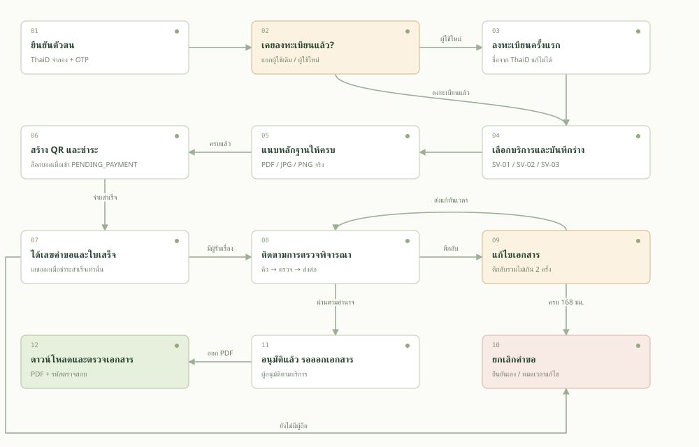
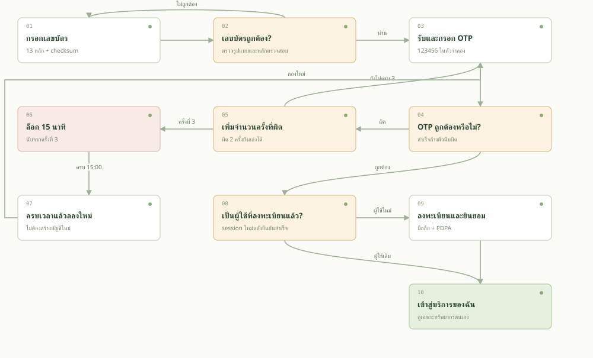
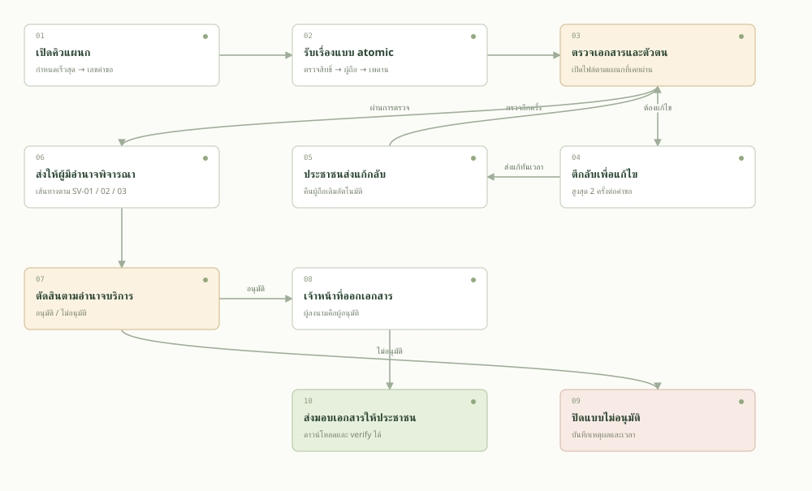
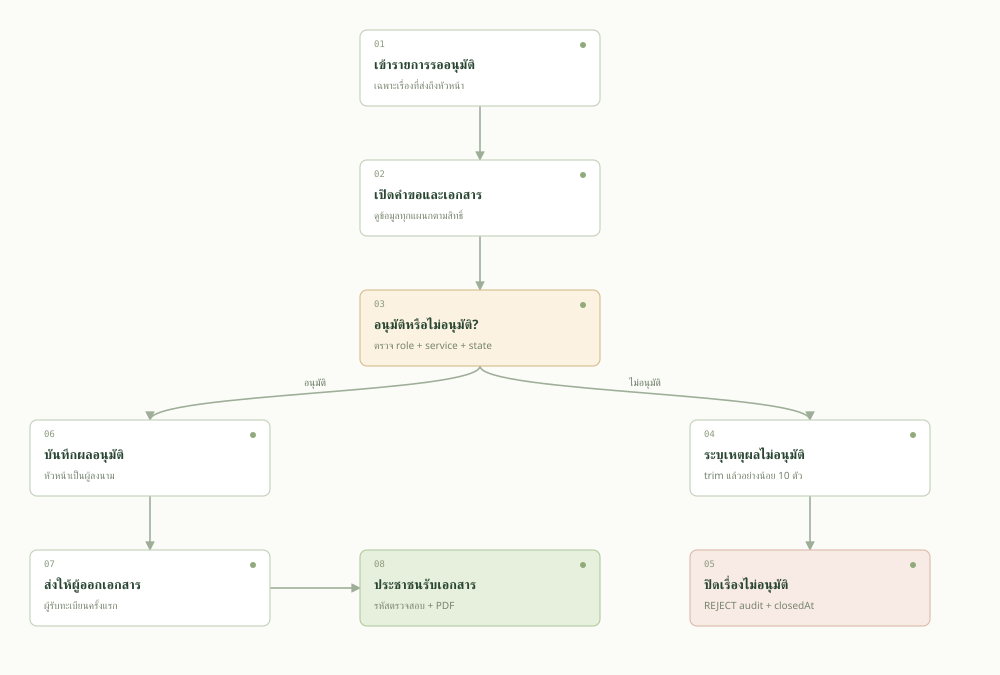
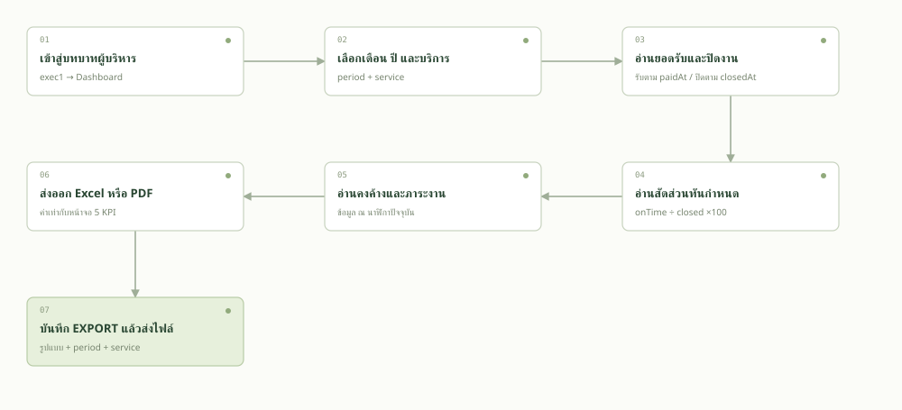
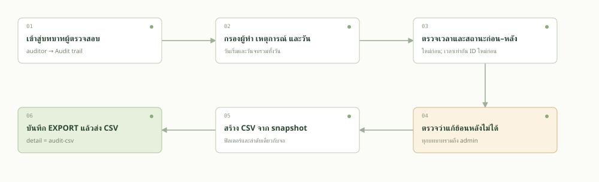
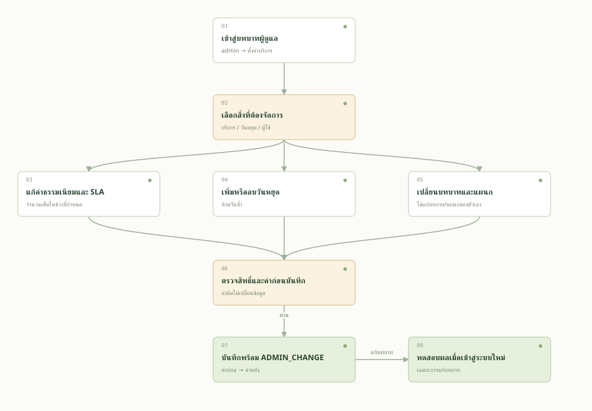
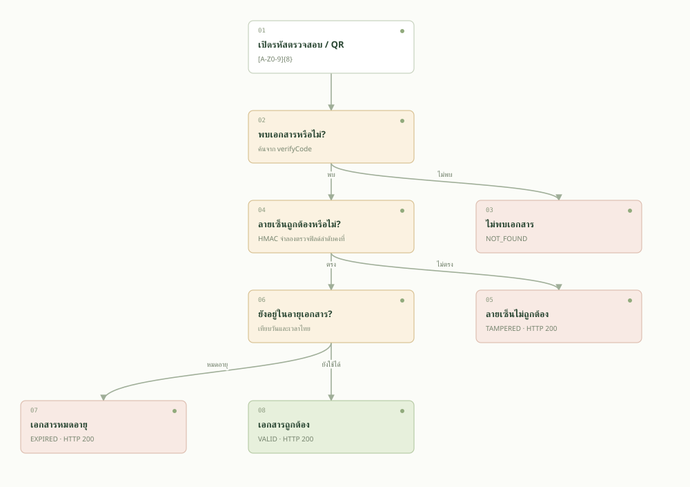
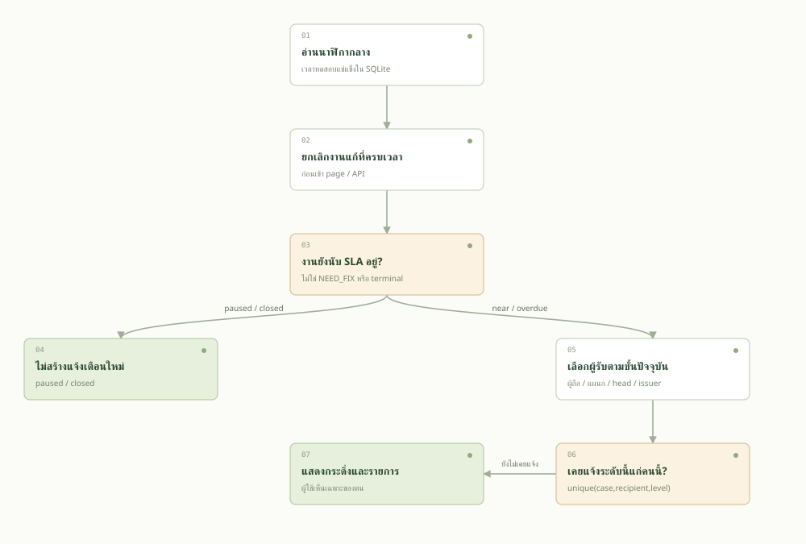
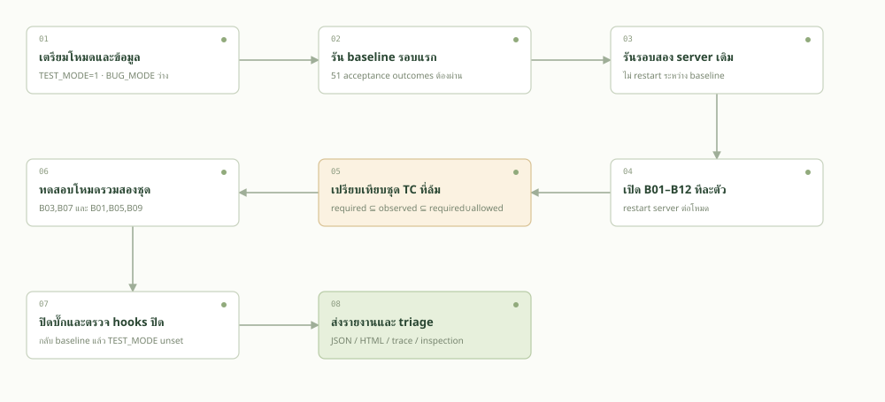

# User flows · e-Service เทศบาลนครตัวอย่าง

แผนภาพสรุปจากเอกสารโจทย์และ Spec Kit; ยังไม่ใช่ผลการรันระบบจริง

## ประชาชน · ยื่นคำขอจนได้รับเอกสาร

วงจรหลักตั้งแต่ยืนยันตัวตน ยื่นและจ่ายเงิน จนได้รับ PDF รวมการแก้ไขและยกเลิกตามเงื่อนไข โดยผู้ใช้เห็นเฉพาะคำขอของตนเอง

| ขั้น | บทบาท / หน้าจอ | สถานะและเงื่อนไข | เกณฑ์ทดสอบ |
| --- | --- | --- | --- |
| ยืนยันตัวตน | ประชาชน · `/login` | ยังไม่เข้าสู่ระบบ → มี session · เลขบัตร 13 หลักและ checksum ถูกต้อง; OTP 123456; ผิดสามครั้งล็อก 15 นาที | TC-AUTH-01 TC-AUTH-02 |
| เคยลงทะเบียนแล้ว? | ระบบ · `/register หรือ /citizen` | registered true / false · ผู้ใช้ใหม่มี session จำกัดเฉพาะลงทะเบียน; ผู้ใช้เดิมไปหน้ารายการได้ทันที | TC-AUTH-03 |
| ลงทะเบียนครั้งแรก | ประชาชน · `/register` | เป็นผู้ใช้ที่ลงทะเบียนแล้ว · มือถือ 10 หลักขึ้นต้น 0; อีเมลไม่บังคับ; ต้องยินยอม PDPA ก่อนใช้งานบริการ | TC-AUTH-03 |
| เลือกบริการและบันทึกร่าง | ประชาชน · `/citizen/new/:service` | DRAFT · กรอกจำนวนหรือพื้นที่ตามบริการ; ร่างยังไม่มีเลข EG และกลับมาทำต่อได้ | TC-FEE-01 TC-SUBMIT-03 |
| แนบหลักฐานให้ครบ | ประชาชน · `/citizen/new/:service` | DRAFT พร้อมไปชำระ · ชนิดจากเนื้อไฟล์; ไฟล์ละ ≤5,242,880 ไบต์ รวม ≤5 ไฟล์; แบบแปลนเป็น PDF; ขาดเอกสารบังคับไปชำระไม่ได้ | TC-UPLOAD-01 TC-UPLOAD-02 TC-SUBMIT-02 |
| สร้าง QR และชำระ | ประชาชน / ธนาคารจำลอง · `/api/test/payments/:ref/pay` | PENDING_PAYMENT → SUBMITTED · อายุ QR <15 นาที; ครบ 15:00 หมดอายุ; ยอดต้องตรง; callback เดิมไม่สร้างคำขอซ้ำ | TC-PAY-01 TC-PAY-02 TC-PAY-03 |
| ได้เลขคำขอและใบเสร็จ | ระบบ / ประชาชน · `/citizen/cases/:caseNo` | SUBMITTED · EG/RC ตามปี พ.ศ. ของเวลาชำระ; ยกเลิกได้เฉพาะยังไม่มีผู้รับเรื่อง พร้อมยืนยันไม่คืนเงิน | TC-SUBMIT-01 TC-SUBMIT-03 TC-PAY-04 |
| ติดตามการตรวจพิจารณา | เจ้าหน้าที่ / หัวหน้า · `/citizen/cases/:caseNo` | IN_REVIEW / PENDING_APPROVAL · เส้นทางอนุมัติตามบริการ ผู้ใช้เลือกปลายทางเองไม่ได้; สถานะ กำหนดเสร็จและเส้นเวลาตรวจสอบได้ | TC-WORKFLOW-01 TC-WORKFLOW-02 TC-WORKFLOW-03 |
| แก้ไขเอกสาร | ประชาชน · `/api/cases/:caseNo/resubmit` | NEED_FIX → IN_REVIEW · ส่งกลับก่อนครบ 168 ชั่วโมงและคืนผู้ถือเดิม; ขยาย SLA ตามวันทำการใน (วันตีกลับ, วันส่งแก้] | TC-SLA-02 TC-WORKFLOW-06 |
| ยกเลิกคำขอ | ประชาชน / ระบบ · `/citizen/cases/:caseNo` | CANCELLED · ครบ 168:00 ชั่วโมง ระบบยกเลิกที่เวลา deadline; ไม่คืนค่าธรรมเนียม; CANCELLED ไม่ใช่ปิดงานใน KPI | TC-SUBMIT-03 TC-WORKFLOW-06 |
| อนุมัติแล้ว รอออกเอกสาร | เจ้าหน้าที่ / หัวหน้า · `/citizen/cases/:caseNo` | APPROVED · SV-01 ผู้ถือเรื่องอนุมัติ; SV-02/03 หัวหน้าอนุมัติ; APPROVED ยังมี SLA จนออกเอกสารเสร็จ | TC-WORKFLOW-01 TC-WORKFLOW-02 TC-WORKFLOW-03 |
| ดาวน์โหลดและตรวจเอกสาร | ประชาชน · `/api/documents/:docNo/pdf` | COMPLETED · ผู้รับทะเบียนครั้งแรกออกเอกสาร SV-02/03; ผู้ลงนามคือผู้อนุมัติ; ตรวจสาธารณะโดยปิดบังชื่อ | TC-DOC-01 TC-DOC-02 TC-DOC-03 |

เส้นเชื่อม: identity → registered, registered → register (ผู้ใช้ใหม่), registered → choose (ลงทะเบียนแล้ว), register → choose, choose → files, files → payment (ครบแล้ว), payment → submitted (จ่ายสำเร็จ), submitted → review (มีผู้รับเรื่อง), review → fix (ตีกลับ), fix → review (ส่งแก้ทันเวลา), fix → cancelled (ครบ 168 ชม.), review → approved (ผ่านตามอำนาจ), approved → completed (ออก PDF), submitted → cancelled (ยังไม่มีผู้ถือ)

## ยืนยันตัวตน · OTP และการลงทะเบียน

ขยายเส้นทางเข้าสู่ระบบประชาชน โดยยึดเวลาเดียวกับเซิร์ฟเวอร์ และไม่ข้ามการลงทะเบียนครั้งแรก

| ขั้น | บทบาท / หน้าจอ | สถานะและเงื่อนไข | เกณฑ์ทดสอบ |
| --- | --- | --- | --- |
| กรอกเลขบัตร | ประชาชน · `/login` | รอเริ่ม OTP · รับการกรอก 14 หลักแล้วตรวจให้ผิดได้; ไม่ถูกต้องตอบ INVALID_ID | TC-AUTH-01 |
| เลขบัตรถูกต้อง? | ระบบ · `/api/auth/thaid/start` | OTP_SENT เมื่อผ่าน · ไม่ผ่านยังอยู่ขั้นเลขบัตร; เลขที่ถูกล็อกตอบ LOCKED | TC-AUTH-01 TC-AUTH-02 |
| รับและกรอก OTP | ประชาชน · `/api/auth/thaid/verify` | กำลังยืนยันตัวตน · ผูกจำนวนครั้งผิดกับเลขบัตร ไม่ใช่แค่ tab; เวลาทั้งหมดอ่านจาก Clock กลาง | TC-AUTH-02 |
| OTP ถูกต้องหรือไม่? | ระบบ · `/api/auth/thaid/verify` | สำเร็จ / OTP_INVALID · OTP ถูกทำให้จำนวนผิดกลับเป็น 0; หากยังล็อกอยู่ OTP ถูกก็เข้าไม่ได้ | TC-AUTH-02 |
| เพิ่มจำนวนครั้งที่ผิด | ระบบ · `/api/auth/thaid/verify` | ครั้งที่ 3 → LOCKED · ครั้งแรกเหลือ 2; ครั้งที่สองเหลือ 1; ครั้งที่สามเริ่มนับเวลาล็อก 15 นาที | TC-AUTH-02 |
| ล็อก 15 นาที | ระบบ · `HTTP 423 LOCKED` | ยังยืนยันไม่ได้ · ผ่าน 14:59 ยังล็อก; ครบ 15:00 ปลดล็อกและตัวนับเริ่มใหม่ | TC-AUTH-02 |
| ครบเวลาแล้วลองใหม่ | ประชาชน · `/login` | OTP เริ่มรอบใหม่ · ครั้งแรกที่ผิดหลังปลดล็อกนับเป็นครั้งที่ 1; reset ล้างล็อกและ session ทุกคน | TC-AUTH-02 TC-NFR-03 |
| เป็นผู้ใช้ที่ลงทะเบียนแล้ว? | ระบบ · `/register หรือ /citizen` | registered true / false · ยังไม่ลงทะเบียนเข้าได้เฉพาะ /register; ผู้ลงทะเบียนแล้วไป /citizen | TC-AUTH-03 |
| ลงทะเบียนและยินยอม | ประชาชน · `/register` | registered = true · ชื่ออ่านอย่างเดียว; มือถือ 0 ตามด้วย 9 หลัก; ไม่ติ๊กยินยอมสมัครไม่ได้; อีเมลเว้นว่างได้ | TC-AUTH-03 |
| เข้าสู่บริการของฉัน | ประชาชน · `/citizen` | พร้อมยื่นบริการ · คนอื่นเปิดคำขอของเราได้ 404; ออกจากระบบได้ผ่าน logout | TC-RBAC-01 TC-RBAC-03 |

เส้นเชื่อม: id → check, check → id (ไม่ถูกต้อง), check → otp (ผ่าน), otp → verify, verify → attempts (ผิด), attempts → otp (ยังไม่ครบ 3), attempts → locked (ครั้งที่ 3), locked → retry (ครบ 15:00), retry → otp (ลองใหม่), verify → registered (ถูกต้อง), registered → register (ผู้ใช้ใหม่), registered → ready (ผู้ใช้เดิม), register → ready

## เจ้าหน้าที่ · รับเรื่อง ตรวจและส่งต่อ

คิวแยกตามแผนกและรับเรื่องแบบผู้ถือเดียว ตีกลับตามเงื่อนไข หรือส่งเข้าสู่ขั้นที่กำหนดโดยบริการ

| ขั้น | บทบาท / หน้าจอ | สถานะและเงื่อนไข | เกณฑ์ทดสอบ |
| --- | --- | --- | --- |
| เปิดคิวแผนก | เจ้าหน้าที่ · `/officer/queue` | คิวงานของแผนก · กำหนดเท่ากันเรียงเลขน้อยก่อน; หัวหน้าเปิดคิวได้แบบอ่านอย่างเดียว | TC-QUEUE-01 |
| รับเรื่องแบบ atomic | เจ้าหน้าที่ · `/api/officer/cases/:caseNo/claim` | SUBMITTED → IN_REVIEW · คนที่สองรับซ้ำได้ 409 ALREADY_CLAIMED; มี 9 รับเป็น 10 ได้; มี 10 รับเพิ่มไม่ได้ | TC-QUEUE-02 TC-QUEUE-03 |
| ตรวจเอกสารและตัวตน | ผู้ถือเรื่อง · `/officer/cases/:caseNo` | IN_REVIEW · ไฟล์: แผนกปัจจุบันหรือเคยผ่านเท่านั้น; unmask ต้องมีเหตุผลและบันทึก UNMASK ก่อนเผย | TC-RBAC-05 TC-PDPA-01 TC-PDPA-02 TC-PDPA-03 |
| ตีกลับเพื่อแก้ไข | ผู้ถือเรื่อง · `/api/officer/cases/:caseNo/return` | NEED_FIX · เหตุผล trim แล้ว ≥10 ตัวอักษร; SLA หยุดนับ; deadline เวลาตีกลับ +168 ชม. | TC-WORKFLOW-04 TC-WORKFLOW-05 |
| ประชาชนส่งแก้กลับ | ประชาชน / ระบบ · `/api/cases/:caseNo/resubmit` | IN_REVIEW · ส่งก่อนครบเวลาและขยาย dueAt ตามวันทำการ; คืนผู้ถือเดิมได้แม้งานรวมเกิน 10 | TC-SLA-02 TC-WORKFLOW-06 TC-QUEUE-03 |
| ส่งให้ผู้มีอำนาจพิจารณา | ระบบ / เจ้าหน้าที่ · `/api/officer/cases/:caseNo/forward` | IN_REVIEW / PENDING_APPROVAL · SV-01 ผู้ถือพิจารณาได้เอง; SV-02 ไปหัวหน้า; SV-03 ไปโยธาแล้วหัวหน้า | TC-WORKFLOW-01 TC-WORKFLOW-02 TC-WORKFLOW-03 |
| ตัดสินตามอำนาจบริการ | ผู้ถือ SV-01 / หัวหน้า SV-02,03 · `/api/cases/:caseNo/approve  /  reject` | APPROVED / REJECTED · เจ้าหน้าที่อนุมัติ SV-02/03 เองไม่ได้; ปฏิเสธต้องมีเหตุผล ≥10 ตัวอักษร | TC-RBAC-02 TC-WORKFLOW-05 |
| เจ้าหน้าที่ออกเอกสาร | ผู้ออกเอกสารที่กำหนด · `/api/officer/cases/:caseNo/issue` | APPROVED → COMPLETED · SV-02/03 ใช้ผู้รับทะเบียนครั้งแรก; ออกเลข DOC แยกจาก EG/RC พร้อม ISSUE audit | TC-DOC-01 |
| ปิดแบบไม่อนุมัติ | ผู้มีอำนาจ · `/officer/cases/:caseNo` | REJECTED · ไม่คืนเงิน; บันทึก REJECT; เป็น closed ใน KPI และใช้ closedAt เทียบ dueAt | TC-WORKFLOW-05 TC-DASH-04 |
| ส่งมอบเอกสารให้ประชาชน | ระบบ · `/citizen/cases/:caseNo` | COMPLETED · บันทึก closedAt ตอนออกเอกสาร; หน้า verify ปิดบังข้อมูลผู้ยื่น | TC-DOC-01 TC-DOC-02 |

เส้นเชื่อม: queue → claim, claim → review, review → return (ต้องแก้ไข), return → resume (ส่งแก้ทันเวลา), resume → review (ตรวจอีกครั้ง), review → routing (ผ่านการตรวจ), routing → decision, decision → issue (อนุมัติ), decision → reject (ไม่อนุมัติ), issue → done

## หัวหน้าฝ่าย · พิจารณาและอนุมัติ

หัวหน้าตัดสิน SV-02/03 เมื่อถึง PENDING_APPROVAL ดูได้ทุกแผนก แต่รับเรื่องหรือตีกลับแทนเจ้าหน้าที่ไม่ได้

| ขั้น | บทบาท / หน้าจอ | สถานะและเงื่อนไข | เกณฑ์ทดสอบ |
| --- | --- | --- | --- |
| เข้ารายการรออนุมัติ | หัวหน้าฝ่าย · `/head/approvals` | PENDING_APPROVAL · SV-02 ผ่านทะเบียน; SV-03 ผ่านทะเบียนและโยธา; หน้าตั้งต้นหลัง login ของ head | TC-AUTH-04 TC-WORKFLOW-02 TC-WORKFLOW-03 |
| เปิดคำขอและเอกสาร | หัวหน้าฝ่าย · `/officer/cases/:caseNo` | กำลังพิจารณา · ไฟล์แนบทุกแผนกเปิดได้; ID ยังปิดบัง; unmask ต้องมีเหตุผลและ audit | TC-RBAC-05 TC-PDPA-01 |
| อนุมัติหรือไม่อนุมัติ? | หัวหน้าฝ่าย · `/api/cases/:caseNo/approve  /  reject` | ตัดสินเฉพาะ SV-02/03 · head อนุมัติ SV-01 ไม่ได้; การซ่อนปุ่มไม่แทนการตรวจสิทธิ์ API | TC-RBAC-02 TC-RBAC-03 |
| ระบุเหตุผลไม่อนุมัติ | หัวหน้าฝ่าย · `/api/cases/:caseNo/reject` | รอเหตุผลที่ผ่านเงื่อนไข · 9 ตัวไม่ผ่าน; 10 ตัวผ่าน; ช่องว่างล้วนไม่ถือเป็นเหตุผล | TC-WORKFLOW-05 |
| ปิดเรื่องไม่อนุมัติ | ระบบ · `/citizen/cases/:caseNo` | REJECTED · แสดงข้อความไม่คืนค่าธรรมเนียม; นับ closed รวมในการคำนวณทันกำหนด | TC-WORKFLOW-05 TC-DASH-04 |
| บันทึกผลอนุมัติ | หัวหน้าฝ่าย · `/api/cases/:caseNo/approve` | APPROVED · บันทึก APPROVE ใน transaction เดียวกัน; ยังไม่ปิด SLA จนออกเอกสาร | TC-WORKFLOW-02 TC-WORKFLOW-03 |
| ส่งให้ผู้ออกเอกสาร | เจ้าหน้าที่ทะเบียน · `/api/officer/cases/:caseNo/issue` | รอ PDF พร้อมส่งมอบ · ไม่ใช้หัวหน้าหรือผู้ถือขั้นโยธาเป็นผู้ออก; เอกสารแสดงชื่อผู้อนุมัติเป็น signer | TC-DOC-01 TC-WORKFLOW-02 |
| ประชาชนรับเอกสาร | ระบบ / ประชาชน · `/citizen/cases/:caseNo` | COMPLETED · ISSUE audit และ closedAt ตอนออกเอกสาร; ตรวจสาธารณะได้โดยไม่เข้าสู่ระบบ | TC-DOC-01 TC-DOC-02 |

เส้นเชื่อม: queue → read, read → decide, decide → reason (ไม่อนุมัติ), reason → rejected, decide → approved (อนุมัติ), approved → issuer, issuer → done

## ผู้บริหาร · Dashboard และรายงาน

มองข้อมูลรวมตามเดือน ปี และบริการ แยกยอดในช่วงเวลาออกจากงานคงค้างปัจจุบัน โดยไม่มีข้อมูลผู้ยื่นส่วนบุคคล

| ขั้น | บทบาท / หน้าจอ | สถานะและเงื่อนไข | เกณฑ์ทดสอบ |
| --- | --- | --- | --- |
| เข้าสู่บทบาทผู้บริหาร | ผู้บริหาร · `/dashboard` | อ่านสรุปได้เท่านั้น · ทำรายการคำขอไม่ได้; ไม่มีชื่อผู้ยื่น เลขบัตรเต็ม หรือมือถือในหน้า/รายงาน | TC-RBAC-03 TC-DASH-03 |
| เลือกเดือน ปี และบริการ | ผู้บริหาร · `/api/dashboard?period=&service=` | ชุดตัวกรองที่เลือก · รายปีรวมยอดก่อนคำนวณเปอร์เซ็นต์; ตัวกรองบริการใช้กับ KPI ตามสัญญา | TC-DASH-01 TC-DASH-02 |
| อ่านยอดรับและปิดงาน | ระบบ · `/dashboard` | received / closed · รับรวมรายการชำระแล้วที่ยกเลิก; ปิดเฉพาะ COMPLETED + REJECTED ไม่รวม CANCELLED | TC-DASH-01 TC-DASH-02 |
| อ่านสัดส่วนทันกำหนด | ระบบ · `kpi-ontime-pct` | ทศนิยม 1 ตำแหน่ง · closedAt ≤ dueAt รวมวินาทีที่พอดี; ปิดงาน 0 แสดง –; ปัดครึ่งขึ้น | TC-DASH-02 TC-DASH-04 |
| อ่านคงค้างและภาระงาน | ระบบ · `/dashboard` | backlog / overdue / workload · คงค้างไม่ถูกกรองตามเดือน; overdue ไม่นับ NEED_FIX; workload รายคนไม่เปลี่ยนตามตัวกรอง Dashboard | TC-DASH-01 TC-DASH-02 |
| ส่งออก Excel หรือ PDF | ผู้บริหาร · `/api/dashboard/export` | ไฟล์รายงานข้อมูลรวม · ไม่มีชื่อผู้ยื่น เลขบัตร หรือมือถือ; ใช้ตัวกรองเดียวกันและรูปแบบไฟล์ตาม CONTRACT | TC-DASH-03 |
| บันทึก EXPORT แล้วส่งไฟล์ | ระบบ · `Audit event: EXPORT` | ส่งออกรายงานสำเร็จ · ไฟล์ต้องสร้างสำเร็จก่อนบันทึกเหตุการณ์; ไม่อ้าง availability หรือ capacity จริงจาก Dashboard | TC-AUDIT-01 TC-DASH-03 |

เส้นเชื่อม: login → filter, filter → counts, counts → ratio, ratio → backlog, backlog → export, export → audit

## ผู้ตรวจสอบ · Audit trail อ่านอย่างเดียว

ค้นประวัติตามผู้ทำ เหตุการณ์ และวันตามเวลาไทย จากนั้นส่งออก snapshot โดยไม่แก้หรือลบรายการย้อนหลัง

| ขั้น | บทบาท / หน้าจอ | สถานะและเงื่อนไข | เกณฑ์ทดสอบ |
| --- | --- | --- | --- |
| เข้าสู่บทบาทผู้ตรวจสอบ | ผู้ตรวจสอบ · `/audit` | อ่านประวัติได้ · ไม่มีสิทธิ์ทำรายการคำขอ; ผู้ดูแลระบบไม่มีสิทธิ์อ่าน Audit แทนผู้ตรวจสอบ | TC-RBAC-03 |
| กรองผู้ทำ เหตุการณ์ และวัน | ผู้ตรวจสอบ · `/api/audit?actor=&event=&from=&to=` | ชุดรายการที่ตรงเงื่อนไข · ใช้ [วันเริ่ม 00:00, วันถัดจากวันจบ 00:00); เขตเวลา Asia/Bangkok | TC-AUDIT-03 |
| ตรวจเวลาและสถานะก่อน–หลัง | ผู้ตรวจสอบ · `/audit` | เหตุการณ์ 10 ประเภท · เห็น username, role, case, detail ตามสัญญา; รายการสำเร็จจึงมี audit; unmask ต้องมีเหตุผล | TC-AUDIT-01 |
| ตรวจว่าแก้ย้อนหลังไม่ได้ | ระบบ · `PUT / PATCH / DELETE /api/audit` | 405 METHOD_NOT_ALLOWED · รวม collection และ ID ที่ไม่มีจริง; ไม่มีปุ่มแก้/ลบในหน้าผู้ตรวจสอบ | TC-AUDIT-02 |
| สร้าง CSV จาก snapshot | ระบบ · `/api/audit/export.csv` | เนื้อไฟล์ก่อนเพิ่ม EXPORT ของตัวเอง · UTF-8 และหัวคอลัมน์ตรง CONTRACT; เช่นชุด TC-AUDIT-01 มี 16 แถวก่อน export | TC-AUDIT-01 |
| บันทึก EXPORT แล้วส่ง CSV | ระบบ · `Audit event: EXPORT` | มีบันทึกการส่งออกเพิ่มอีก 1 แถว · ตัว CSV ไม่รวม EXPORT ของการส่งออกครั้งนี้; เมื่อเปิดรายการใหม่เห็นเหตุการณ์ส่งออกแล้ว | TC-AUDIT-01 |

เส้นเชื่อม: login → filters, filters → read, read → immutable, immutable → snapshot, snapshot → export

## ผู้ดูแลระบบ · บริการ วันหยุด และผู้ใช้

การเปลี่ยนค่าตั้งต้นไม่เปลี่ยนยอดหรือกำหนดเสร็จที่ล็อกไว้แล้ว ทุกการแก้ที่สำเร็จมี ADMIN_CHANGE

| ขั้น | บทบาท / หน้าจอ | สถานะและเงื่อนไข | เกณฑ์ทดสอบ |
| --- | --- | --- | --- |
| เข้าสู่บทบาทผู้ดูแล | ผู้ดูแลระบบ · `/admin/services` | จัดการข้อมูลตั้งต้น · ไม่มีสิทธิ์ทำรายการคำขอ; แก้/ลบ Audit ไม่ได้ | TC-RBAC-03 |
| เลือกสิ่งที่ต้องจัดการ | ผู้ดูแลระบบ · `/admin/*` | เข้าสู่ฟอร์มตั้งค่า · ไม่เพิ่มหรือลบบริการนอก 3 รหัสเดิม; จัดการเฉพาะขอบเขตที่โจทย์กำหนด | TC-RBAC-04 |
| แก้ค่าธรรมเนียมและ SLA | ผู้ดูแลระบบ · `PUT /api/admin/services/:id` | ค่าใหม่สำหรับรายการในอนาคต · ค่าธรรมเนียม 0–100,000 บาท; SLA 1–60 วัน; ยอดที่เข้า PENDING_PAYMENT แล้วไม่เปลี่ยน | TC-RBAC-04 TC-RBAC-06 |
| เพิ่มหรือลบวันหยุด | ผู้ดูแลระบบ · `/api/admin/holidays` | ปฏิทินฉบับปัจจุบัน · dueAt ของคำขอชำระแล้วไม่คำนวณใหม่; ขยาย SLA เมื่อส่งแก้ใช้วันหยุด ณ ตอนส่งแก้ | TC-RBAC-04 TC-RBAC-06 |
| เปลี่ยนบทบาทและแผนก | ผู้ดูแลระบบ · `PUT /api/admin/users/:username` | ค่าตัวตนที่แก้ไว้ · เปลี่ยนของตัวเองตอบ SELF_ROLE_CHANGE; สิทธิ์ใหม่มีผลเมื่อคนนั้น login ครั้งถัดไป | TC-RBAC-04 TC-RBAC-06 |
| ตรวจสิทธิ์และค่าก่อนบันทึก | ระบบ · `Admin domain service` | สำเร็จ / validation error · ตัวเลขนอกช่วงหรือไม่เป็นจำนวนเต็มได้ 400; วันหยุดซ้ำ / self-role change ได้ 409 | TC-RBAC-06 |
| บันทึกพร้อม ADMIN_CHANGE | ระบบ · `Audit event: ADMIN_CHANGE` | การเปลี่ยนสำเร็จ atomic · ข้อมูลและ audit สำเร็จหรือ rollback พร้อมกัน; รูปแบบ detail ต้องตรง CONTRACT | TC-AUDIT-01 TC-RBAC-04 |
| ทดสอบผลเมื่อเข้าสู่ระบบใหม่ | ผู้ใช้ที่ถูกเปลี่ยนบทบาท · `/login` | session ใหม่รับสิทธิ์ใหม่ · session เดิมยังถือ role/dept snapshot; reset ล้างทุก session และคืน seed | TC-RBAC-04 |

เส้นเชื่อม: login → choose, choose → service, choose → holiday, choose → users, service → validate, holiday → validate, users → validate, validate → audit (ผ่าน), audit → nextlogin (แก้บทบาท)

## สาธารณะ · ตรวจเอกสารดิจิทัล

ไม่ต้องเข้าสู่ระบบ ตรวจรหัส ลายเซ็น และอายุเอกสารตามลำดับ โดยไม่เปิดเผยข้อมูลเอกสารที่ลายเซ็นไม่ถูกต้อง

| ขั้น | บทบาท / หน้าจอ | สถานะและเงื่อนไข | เกณฑ์ทดสอบ |
| --- | --- | --- | --- |
| เปิดรหัสตรวจสอบ / QR | ผู้ตรวจเอกสาร · `/verify/:code` | เริ่มตรวจเอกสาร · รหัสมาจาก PDF/QR ที่ออกโดยระบบ; ไม่ต้องล็อกอิน | TC-DOC-01 TC-DOC-02 |
| พบเอกสารหรือไม่? | ระบบ · `GET /api/verify/:code` | พบ / ไม่พบ · รหัสไม่พบตอบ HTTP 404; รหัสที่พบตอบ 200 ตามผลตรวจ | TC-DOC-02 |
| ไม่พบเอกสาร | ระบบ · `/verify/:code` | HTTP 404 · แสดง ไม่พบเอกสาร; ไม่เผยข้อมูลผู้ยื่นหรือข้อมูลเอกสาร | TC-DOC-02 |
| ลายเซ็นถูกต้องหรือไม่? | ระบบ · `Document verification` | ตรวจ signature ก่อนอายุ · ฟิลด์ตาม CONTRACT §3 / A-22; tamper เปลี่ยนข้อมูลแต่ไม่เซ็นใหม่ | TC-DOC-03 |
| ลายเซ็นไม่ถูกต้อง | ระบบ · `/api/verify/:code` | ผล JSON มีเฉพาะ result · ไม่คืนชื่อหรือรายละเอียดที่เชื่อถือไม่ได้; ทดสอบจาก tamper hook | TC-DOC-03 |
| ยังอยู่ในอายุเอกสาร? | ระบบ · `Document validity` | ตรวจ validUntil แบบรวมวันสุดท้าย · SV-01 ออก +89 วัน; SV-02/03 วันครบรอบ−1 วัน; กรณี 29 ก.พ. ใช้ clamp ก่อนลบวัน | TC-DOC-03 |
| เอกสารหมดอายุ | ระบบ · `/verify/:code` | หมดอายุตั้งแต่เที่ยงคืนวันถัดไป · ยังแสดงข้อมูลที่ผ่าน signature แบบปิดบังชื่อ; ไม่มีนามสกุลใช้ ชื่อ + " ***" | TC-DOC-03 |
| เอกสารถูกต้อง | ระบบ · `/verify/:code` | ตรวจผ่านตามตัวจำลอง · ชื่อเต็ม + ตัวแรกนามสกุล +***; ลายเซ็นจำลองไม่ใช่การรับรอง CA จริง | TC-DOC-02 TC-DOC-03 |

เส้นเชื่อม: code → exists, exists → missing (ไม่พบ), exists → signature (พบ), signature → tampered (ไม่ตรง), signature → expiry (ตรง), expiry → expired (หมดอายุ), expiry → valid (ยังใช้ได้)

## ระบบ · นาฬิกา SLA และการแจ้งเตือน

ทุก HTTP request ยกเว้น /api/test/* ประเมินหมดเวลาแก้ไขและระดับเตือนจากนาฬิกาเดียวกัน ไม่รอ cron และไม่แจ้งย้อนหลังทุกระดับที่ข้ามไป

| ขั้น | บทบาท / หน้าจอ | สถานะและเงื่อนไข | เกณฑ์ทดสอบ |
| --- | --- | --- | --- |
| อ่านนาฬิกากลาง | ระบบ · `Custom Node HTTP entry` | now ใน Asia/Bangkok · ทุกกฎธุรกิจอ่าน Clock กลาง; PUT clock เพียงเปลี่ยนเวลา ไม่ประเมินแจ้งเตือน | TC-NFR-03 TC-NOTI-02 |
| ยกเลิกงานแก้ที่ครบเวลา | ระบบ · `ทุก HTTP ยกเว้น /api/test/*` | NEED_FIX ครบเวลา → CANCELLED · รวม health, verify และ asset requests; timestamp การยกเลิกคือ deadline แม้ request มาช้า | TC-WORKFLOW-06 |
| งานยังนับ SLA อยู่? | ระบบ · `SLA service` | normal / near / overdue / paused / closed · normal เหลือวันทำการ ≥2; near เหลือ ≤1 และ now≤due; overdue now>due | TC-SLA-03 |
| ไม่สร้างแจ้งเตือนใหม่ | ระบบ · `Notification evaluation` | ข้ามคำขอนี้ · NEED_FIX หยุดเตือน; COMPLETED/REJECTED/CANCELLED ไม่แจ้งใหม่ | TC-SLA-03 TC-NOTI-02 |
| เลือกผู้รับตามขั้นปัจจุบัน | ระบบ · `Notification recipient rules` | ผู้รับ near หรือ overdue · ไม่มีผู้ถือแจ้งทั้งแผนก; รออนุมัติแจ้ง head; APPROVED แจ้ง issuer; overdue เพิ่ม head โดยไม่ซ้ำคน | TC-NOTI-01 TC-NOTI-02 |
| เคยแจ้งระดับนี้แก่คนนี้? | ระบบ · `SQLite notification inbox` | สร้างเฉพาะที่ยังไม่เคยมี · ข้ามจาก normal ไป overdue ไม่สร้าง near ย้อนหลัง; เปิดหน้าซ้ำไม่เพิ่มแถวซ้ำ | TC-NOTI-02 |
| แสดงกระดิ่งและรายการ | เจ้าหน้าที่ / หัวหน้า · `/notifications` | แจ้งเตือนถูกต้องครั้งเดียว · seed หลัง reset ยังว่าง จนมี request ปกติ; SLA ยังเดินใน APPROVED จนออกเอกสาร | TC-NOTI-01 TC-NOTI-02 |

เส้นเชื่อม: clock → lifecycle, lifecycle → eligible, eligible → skip (paused / closed), eligible → recipient (near / overdue), recipient → dedupe, dedupe → inbox (ยังไม่เคยแจ้ง)

## ทีมพัฒนา · ตรวจรับและพิสูจน์การจับบั๊ก

แผนตรวจรับ 51 IDs ประกอบด้วย 50 browser/API cases และ 1 database/filesystem inspection ทุก TC เริ่ม reset แล้วเข้าสู่ระบบใหม่

| ขั้น | บทบาท / หน้าจอ | สถานะและเงื่อนไข | เกณฑ์ทดสอบ |
| --- | --- | --- | --- |
| เตรียมโหมดและข้อมูล | ทีมพัฒนา · `Acceptance campaign` | พร้อมทดสอบ baseline · ใช้ DB_PATH และนาฬิกาทดสอบร่วม; workers=1; concurrency เฉพาะใน race TC | TC-NFR-03 |
| รัน baseline รอบแรก | ทีมพัฒนา · `Playwright runner + inspector` | baseline-1 ผ่านทั้งหมด · NFR-04 เรียก standalone inspector ผ่าน wrapper; ไม่ใช้ browser assertions อ้างการเข้ารหัส at rest | TC-NFR-04 |
| รันรอบสอง server เดิม | ทีมพัฒนา · `baseline-2` | ผลเดิมครบ 51 IDs · reset ล้าง session ทุกคนก่อนทุก TC; รวม fresh login เมื่อ reset กลาง TC | TC-NFR-03 |
| เปิด B01–B12 ทีละตัว | ทีมพัฒนา · `Full unchanged acceptance suite` | 12 single-mutant runs · ห้ามแก้ seed หรือ expected values เพื่อให้ผ่าน; บั๊กเปลี่ยนตรรกะฝั่งเซิร์ฟเวอร์เฉพาะจุด | TC-FEE-01 TC-QUEUE-02 TC-RBAC-02 |
| เปรียบเทียบชุด TC ที่ล้ม | ทีมพัฒนา · `BUGS.md failure matrix` | ทุก mandatory failure ต้องเกิด · timeout / element หาย ไม่ใช่หลักฐานค่าผิด; บันทึก assertion expected เทียบ actual | TC-SLA-01 TC-PDPA-02 TC-AUDIT-01 |
| ทดสอบโหมดรวมสองชุด | ทีมพัฒนา · `Combined mutation runs` | ผลล้มเป็น union ตามกติกา · แยก mandatory กับ allowed additional failures; test suite และ assertions เดิม | TC-RBAC-02 TC-PAY-01 TC-PDPA-02 |
| ปิดบั๊กและตรวจ hooks ปิด | ทีมพัฒนา · `Final baseline / hooks-disabled` | 51 ผ่าน + test endpoints 404 · health และ verify ยังใช้ได้เมื่อปิด hooks; ไม่อ้าง 99.5% availability จาก local health | TC-NFR-03 |
| ส่งรายงานและ triage | ทีมพัฒนา · `web/evidence/ (ตามแผน)` | หลักฐานตรวจรับครบ · ระบุ runtime, mode และค่าที่ตรวจจริง; เอกสารปัจจุบันยังไม่ใช่ผลรันแอป | TC-NFR-01 TC-NFR-02 TC-NFR-03 TC-NFR-04 |

เส้นเชื่อม: prepare → baseline, baseline → repeat, repeat → single, single → compare, compare → combined, combined → clean, clean → evidence
