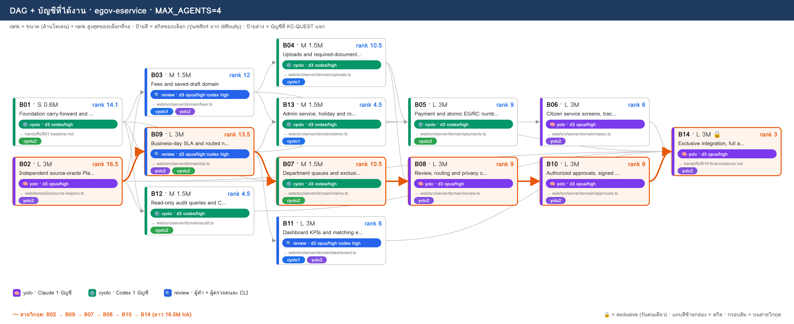

# PLAN · egov-eservice

**โจทย์:** Continue the approved C municipal e-Service from verified T001-T020 to full source-contract acceptance; planning and review only.

วางแผนเมื่อ 22/11/2026 22:16 · MAX_AGENTS 4 · บัญชี cyolo1, cyolo2, yolo2 · ตัวปรับเวลา k (ยังไม่มี calib.json → k=1)

> แผนนี้ยังไม่ได้รันจริง — KC-QUEST เลือกบัญชีจากโควตา แล้วจำลองเวลาตาม dependency

## 1) โควตาของแต่ละบัญชี

| บัญชี | แพลน | ใช้ไป 5 ชม. | ใช้ไปสัปดาห์ | headroom | รีเซ็ต/หมดอายุ (ชม.) | U | slot | ที่มา |
|---|---|---|---|---|---|---|---|---|
| cyolo1 | default | 0% | 0% | **100%** | 168.0 | 0.125 | 3 | team.py quota |
| cyolo2 | prolite | 0% | 0% | **100%** | 116.1 | 0.171 | 3 | team.py quota |
| yolo2 | default | 1% | 8% | **92%** | 27.7 | 0.464 | 3 | team.py quota |

## 2) DAG + สกิล + บัญชี

**สายวิกฤต:** B02 → B09 → B07 → B08 → B10 → B14 · ยาว 16.5M tok

## 3) ตารางแจกงาน (เหตุผล KC-QUEST ทุกบล็อก)

| บล็อก | สกิล | ชื่อ | ขนาด · c | รอ | rank | บัญชี (บทบาท) | เริ่ม–จบ (นาที) | เหตุผล KC-QUEST |
|---|---|---|---|---|---|---|---|---|
| **B02** | 🧠 yolo | Independent source-oracle Playwright authoring | L · 3 | – | 16.5 | yolo2 (ทำ) | 0.0–25.0 | ทำ: yolo2 47.5 (U=0.464 F=0.011 S=0.912 S=1.0 L=0.0) · 3.00M ≈ 5ชม. 7.8% / สัปดาห์ 0.98% |
| B01 | ⚙️ cyolo | Foundation carry-forward and reproducible packaging | S · 0.6 | – | 14.1 | cyolo2 (ทำ) | 0.0–7.5 | ทำ: cyolo2 30.6 (U=0.171 F=0.002 S=0.984 S=0.598 L=0.0) · 0.60M ≈ 5ชม. 1.56% / สัปดาห์ 0.2% · อันดับ 2 cyolo1 28.8 |
| **B09** | 🔍 review | Business-day SLA and routed notifications | L · 3 | B01, B02 | 13.5 | yolo2 (ทำ), cyolo2 (ตรวจ) | 25.0–61.2 | ทำ: yolo2 43.6 (U=0.464 F=0.011 S=0.834 S=0.818 L=0.0) · 3.00M ≈ 5ชม. 7.8% / สัปดาห์ 0.98%   ตรวจ: cyolo2 29.9 (U=0.171 F=0.003 S=0.961 S=0.573 L=0.0) · 0.90M ≈ 5ชม. 2.34% / สัปดาห์ 0.29% · อันดับ 2 cyolo1 28.3 |
| B03 | 🔍 review | Fees and saved-draft domain | M · 1.5 | B01, B02 | 12 | cyolo1 (ทำ), yolo2 (ตรวจ) | 25.0–47.5 | ทำ: cyolo1 27.2 (U=0.125 F=0.005 S=0.961 S=0.509 L=0.0) · 1.50M ≈ 5ชม. 3.9% / สัปดาห์ 0.49% · อันดับ 2 cyolo2 25.1   ตรวจ: yolo2 38.5 (U=0.464 F=0.002 S=0.822 S=0.727 L=0.333) · 0.45M ≈ 5ชม. 1.17% / สัปดาห์ 0.15% |
| B04 | ⚙️ cyolo | Uploads and required-document completeness | M · 1.5 | B03 | 10.5 | cyolo1 (ทำ) | 47.5–66.2 | ทำ: cyolo1 25.6 (U=0.125 F=0.005 S=0.922 S=0.445 L=0.0) · 1.50M ≈ 5ชม. 3.9% / สัปดาห์ 0.49% · อันดับ 2 cyolo2 24.1 |
| B12 | ⚙️ cyolo | Read-only audit queries and CSV | M · 1.5 | B01, B02 | 4.5 | cyolo2 (ทำ) | 47.5–66.2 | ทำ: cyolo2 20.3 (U=0.171 F=0.005 S=0.922 S=0.191 L=0.333) · 1.50M ≈ 5ชม. 3.9% / สัปดาห์ 0.49% · อันดับ 2 cyolo1 17.9 |
| **B07** | ⚙️ cyolo | Department queues and exclusive claims | M · 1.5 | B01, B02, B09 | 10.5 | cyolo2 (ทำ) | 61.2–80.0 | ทำ: cyolo2 23.5 (U=0.171 F=0.005 S=0.883 S=0.445 L=0.333) · 1.50M ≈ 5ชม. 3.9% / สัปดาห์ 0.49% · อันดับ 2 cyolo1 21.7 |
| B13 | ⚙️ cyolo | Admin service, holiday and role settings | M · 1.5 | B03, B09 | 4.5 | cyolo1 (ทำ) | 61.2–80.0 | ทำ: cyolo1 17.9 (U=0.125 F=0.005 S=0.883 S=0.191 L=0.333) · 1.50M ≈ 5ชม. 3.9% / สัปดาห์ 0.49% · อันดับ 2 cyolo2 15.8 |
| B05 | ⚙️ cyolo | Payment and atomic EG/RC numbering | L · 3 | B03, B04, B09 | 9 | cyolo2 (ทำ) | 66.2–103.7 | ทำ: cyolo2 21.5 (U=0.171 F=0.01 S=0.805 S=0.382 L=0.333) · 3.00M ≈ 5ชม. 7.8% / สัปดาห์ 0.98% · อันดับ 2 cyolo1 19.7 |
| **B08** | 🧠 yolo | Review, routing and privacy controls | L · 3 | B04, B07 | 9 | yolo2 (ทำ) | 80.0–105.0 | ทำ: yolo2 38.1 (U=0.464 F=0.011 S=0.744 S=0.545 L=0.0) · 3.00M ≈ 5ชม. 7.8% / สัปดาห์ 0.98% |
| B11 | 🔍 review | Dashboard KPIs and matching exports | L · 3 | B09 | 6 | cyolo1 (ทำ), yolo2 (ตรวจ) | 80.0–125.0 | ทำ: cyolo1 21.1 (U=0.125 F=0.01 S=0.805 S=0.255 L=0.0) · 3.00M ≈ 5ชม. 7.8% / สัปดาห์ 0.98% · อันดับ 2 cyolo2 18.4   ตรวจ: yolo2 31.6 (U=0.464 F=0.003 S=0.721 S=0.364 L=0.333) · 0.90M ≈ 5ชม. 2.34% / สัปดาห์ 0.29% |
| B06 | 🧠 yolo | Citizen service screens, tracking and corrections | L · 3 | B05 | 6 | yolo2 (ทำ) | 103.7–128.7 | ทำ: yolo2 27.2 (U=0.464 F=0.011 S=0.643 S=0.364 L=0.667) · 3.00M ≈ 5ชม. 7.8% / สัปดาห์ 0.98% |
| **B10** | 🧠 yolo | Authorized approvals, signed PDF and public verify | L · 3 | B08 | 6 | yolo2 (ทำ) | 105.0–130.0 | ทำ: yolo2 26.0 (U=0.464 F=0.011 S=0.565 S=0.364 L=0.667) · 3.00M ≈ 5ชม. 7.8% / สัปดาห์ 0.98% |
| **B14** | 🧠 yolo | Exclusive integration, full acceptance and mutation evidence | L · 3 | B02, B06, B10, B11, B12, B13 | 3 | yolo2 (ทำ) | 130.0–155.0 | ทำ: yolo2 28.8 (U=0.464 F=0.011 S=0.487 S=0.182 L=0.0) · 3.00M ≈ 5ชม. 7.8% / สัปดาห์ 0.98% |

## 4) Gantt แผน

## 5) รอบแจกงาน

| นาทีที่ | บล็อกที่เริ่ม |
|---|---|
| 0 | B02→yolo2, B01→cyolo2 |
| 25 | B09→yolo2+cyolo2, B03→cyolo1+yolo2 |
| 47.5 | B04→cyolo1, B12→cyolo2 |
| 61.2 | B07→cyolo2, B13→cyolo1 |
| 66.2 | B05→cyolo2 |
| 80 | B08→yolo2, B11→cyolo1+yolo2 |
| 103.7 | B06→yolo2 |
| 105 | B10→yolo2 |
| 130 | B14→yolo2 |

## 6) สรุป

- บล็อก 14 · แจกได้ 14 · agent พร้อมกันสูงสุด 4/4
- เวลาประมาณ 155.0 นาที (แท่ง Gantt) · ไฟล์ผลของทีม: `/workspace/plans/egov-eservice/app/`

ต่อไป: `dagplan.py export egov-eservice` → `dagplan.py run egov-eservice` → `dagplan.py report egov-eservice`
