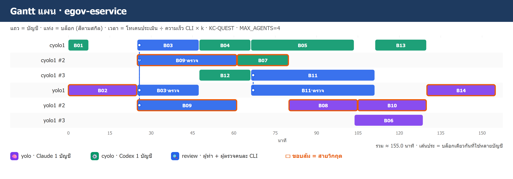

# PLAN · egov-eservice

**โจทย์:** Continue the approved C municipal e-Service from verified T001-T020 to full source-contract acceptance; planning and review only.

วางแผนเมื่อ 18/11/2026 16:41 · MAX_AGENTS 4 · บัญชี cyolo1, yolo1 · ตัวปรับเวลา k (ยังไม่มี calib.json → k=1)

> แผนนี้ยังไม่ได้รันจริง — KC-QUEST เลือกบัญชีจากโควตา แล้วจำลองเวลาตาม dependency

## 1) โควตาของแต่ละบัญชี

| บัญชี | แพลน | ใช้ไป 5 ชม. | ใช้ไปสัปดาห์ | headroom | รีเซ็ต/หมดอายุ (ชม.) | U | slot | ที่มา |
|---|---|---|---|---|---|---|---|---|
| cyolo1 | default | 20% | 0% | **80%** | 168.0 | 0.125 | 3 | สมมติ (--accounts) |
| yolo1 | default | 20% | 0% | **80%** | 168.0 | 0.125 | 3 | สมมติ (--accounts) |

- ⚠ ทุกบัญชีเป็นค่าสมมติ (--accounts มี % ครบ) → ไม่ได้เรียก team.py check/quota

## 2) DAG + สกิล + บัญชี

**สายวิกฤต:** B02 → B09 → B07 → B08 → B10 → B14 · ยาว 16.5M tok

## 3) ตารางแจกงาน (เหตุผล KC-QUEST ทุกบล็อก)

| บล็อก | สกิล | ชื่อ | ขนาด · c | รอ | rank | บัญชี (บทบาท) | เริ่ม–จบ (นาที) | เหตุผล KC-QUEST |
|---|---|---|---|---|---|---|---|---|
| **B02** | 🧠 yolo | Independent source-oracle Playwright authoring | L · 3 | – | 16.5 | yolo1 (ทำ) | 0.0–25.0 | ทำ: yolo1 31.0 (U=0.125 F=0.01 S=0.722 S=1.0 L=0.0) · 3.00M ≈ 5ชม. 7.8% / สัปดาห์ 0.98% |
| B01 | ⚙️ cyolo | Foundation carry-forward and reproducible packaging | S · 0.6 | – | 14.1 | cyolo1 (ทำ) | 0.0–7.5 | ทำ: cyolo1 25.8 (U=0.125 F=0.002 S=0.784 S=0.598 L=0.0) · 0.60M ≈ 5ชม. 1.56% / สัปดาห์ 0.2% |
| **B09** | 🔍 review | Business-day SLA and routed notifications | L · 3 | B01, B02 | 13.5 | yolo1 (ทำ), cyolo1 (ตรวจ) | 25.0–61.2 | ทำ: yolo1 27.1 (U=0.125 F=0.01 S=0.644 S=0.818 L=0.0) · 3.00M ≈ 5ชม. 7.8% / สัปดาห์ 0.98%   ตรวจ: cyolo1 25.1 (U=0.125 F=0.003 S=0.761 S=0.573 L=0.0) · 0.90M ≈ 5ชม. 2.34% / สัปดาห์ 0.29% |
| B03 | 🔍 review | Fees and saved-draft domain | M · 1.5 | B01, B02 | 12 | cyolo1 (ทำ), yolo1 (ตรวจ) | 25.0–47.5 | ทำ: cyolo1 20.2 (U=0.125 F=0.005 S=0.722 S=0.509 L=0.333) · 1.50M ≈ 5ชม. 3.9% / สัปดาห์ 0.49%   ตรวจ: yolo1 22.1 (U=0.125 F=0.001 S=0.632 S=0.727 L=0.333) · 0.45M ≈ 5ชม. 1.17% / สัปดาห์ 0.15% |
| B04 | ⚙️ cyolo | Uploads and required-document completeness | M · 1.5 | B03 | 10.5 | cyolo1 (ทำ) | 47.5–66.2 | ทำ: cyolo1 18.7 (U=0.125 F=0.005 S=0.683 S=0.445 L=0.333) · 1.50M ≈ 5ชม. 3.9% / สัปดาห์ 0.49% |
| B12 | ⚙️ cyolo | Read-only audit queries and CSV | M · 1.5 | B01, B02 | 4.5 | cyolo1 (ทำ) | 47.5–66.2 | ทำ: cyolo1 11.0 (U=0.125 F=0.005 S=0.644 S=0.191 L=0.667) · 1.50M ≈ 5ชม. 3.9% / สัปดาห์ 0.49% |
| **B07** | ⚙️ cyolo | Department queues and exclusive claims | M · 1.5 | B01, B02, B09 | 10.5 | cyolo1 (ทำ) | 61.2–80.0 | ทำ: cyolo1 14.2 (U=0.125 F=0.005 S=0.605 S=0.445 L=0.667) · 1.50M ≈ 5ชม. 3.9% / สัปดาห์ 0.49% |
| B05 | ⚙️ cyolo | Payment and atomic EG/RC numbering | L · 3 | B03, B04, B09 | 9 | cyolo1 (ทำ) | 66.2–103.7 | ทำ: cyolo1 15.5 (U=0.125 F=0.01 S=0.527 S=0.382 L=0.333) · 3.00M ≈ 5ชม. 7.8% / สัปดาห์ 0.98% |
| B11 | 🔍 review | Dashboard KPIs and matching exports | L · 3 | B09 | 6 | cyolo1 (ทำ), yolo1 (ตรวจ) | 66.2–111.2 | ทำ: cyolo1 9.1 (U=0.125 F=0.01 S=0.449 S=0.255 L=0.667) · 3.00M ≈ 5ชม. 7.8% / สัปดาห์ 0.98%   ตรวจ: yolo1 19.7 (U=0.125 F=0.003 S=0.609 S=0.364 L=0.0) · 0.90M ≈ 5ชม. 2.34% / สัปดาห์ 0.29% |
| **B08** | 🧠 yolo | Review, routing and privacy controls | L · 3 | B04, B07 | 9 | yolo1 (ทำ) | 80.0–105.0 | ทำ: yolo1 18.0 (U=0.125 F=0.01 S=0.531 S=0.545 L=0.333) · 3.00M ≈ 5ชม. 7.8% / สัปดาห์ 0.98% |
| B06 | 🧠 yolo | Citizen service screens, tracking and corrections | L · 3 | B05 | 6 | yolo1 (ทำ) | 103.7–128.7 | ทำ: yolo1 10.8 (U=0.125 F=0.01 S=0.453 S=0.364 L=0.667) · 3.00M ≈ 5ชม. 7.8% / สัปดาห์ 0.98% |
| **B10** | 🧠 yolo | Authorized approvals, signed PDF and public verify | L · 3 | B08 | 6 | yolo1 (ทำ) | 105.0–130.0 | ทำ: yolo1 9.6 (U=0.125 F=0.01 S=0.375 S=0.364 L=0.667) · 3.00M ≈ 5ชม. 7.8% / สัปดาห์ 0.98% |
| B13 | ⚙️ cyolo | Admin service, holiday and role settings | M · 1.5 | B03, B09 | 4.5 | cyolo1 (ทำ) | 111.2–130.0 | ทำ: cyolo1 14.1 (U=0.125 F=0.005 S=0.41 S=0.191 L=0.0) · 1.50M ≈ 5ชม. 3.9% / สัปดาห์ 0.49% |
| **B14** | 🧠 yolo | Exclusive integration, full acceptance and mutation evidence | L · 3 | B02, B06, B10, B11, B12, B13 | 3 | yolo1 (ทำ) | 130.0–155.0 | ทำ: yolo1 12.4 (U=0.125 F=0.01 S=0.297 S=0.182 L=0.0) · 3.00M ≈ 5ชม. 7.8% / สัปดาห์ 0.98% |

## 4) Gantt แผน

## 5) รอบแจกงาน

| นาทีที่ | บล็อกที่เริ่ม |
|---|---|
| 0 | B02→yolo1, B01→cyolo1 |
| 25 | B09→yolo1+cyolo1, B03→cyolo1+yolo1 |
| 47.5 | B04→cyolo1, B12→cyolo1 |
| 61.2 | B07→cyolo1 |
| 66.2 | B05→cyolo1, B11→cyolo1+yolo1 |
| 80 | B08→yolo1 |
| 103.7 | B06→yolo1 |
| 105 | B10→yolo1 |
| 111.2 | B13→cyolo1 |
| 130 | B14→yolo1 |

## 6) สรุป

- บล็อก 14 · แจกได้ 14 · agent พร้อมกันสูงสุด 4/4
- เวลาประมาณ 155.0 นาที (แท่ง Gantt) · ไฟล์ผลของทีม: `/workspace/plans/egov-eservice/app/`

ต่อไป: `dagplan.py export egov-eservice` → `dagplan.py run egov-eservice` → `dagplan.py report egov-eservice`

## 7) หมายเหตุการวางแผนใหม่ (Claude + Codex)

- แผนนี้สร้างด้วย `dagplan.py dag/plan` ตัวจริงบน host ด้วยโควตาสมมติ `--accounts yolo1:80,cyolo1:80 --max-agents 4` เพราะ Docker engine ยังไม่พร้อม · ต้องรัน `doctor` และ `plan` ซ้ำใน container ด้วยโควตาจริงก่อนขั้น 3
- สมมติว่ามี Claude 1 บัญชี (`yolo1`) และ Codex 1 บัญชี (`cyolo1`) · ถ้ามีบัญชีมากกว่านี้ให้เพิ่มใน `--accounts` แล้ว `plan` ใหม่
- สกิล: yolo = B02 B06 B08 B10 B14 · cyolo = B01 B04 B05 B07 B12 B13 · review ข้าม CLI = B03 (Codex ทำ/Claude ตรวจ) B09 (Claude ทำ/Codex ตรวจ) B11 (Codex ทำ/Claude ตรวจ)
- T001–T020 ทำเสร็จแล้วในเว็บเดิม · นำเข้าเป็น `app/` ก่อน `export` (ดู `HANDOFF-CLAUDE.md`)
- แผน Claude คิวเดียวเดิมเก็บไว้ที่ `_prev-claude-only/` · `validate_plan.py` เดิมตรวจกฎ "ทุกบล็อกใช้ Claude" จึงไม่ใช้กับแผนนี้
