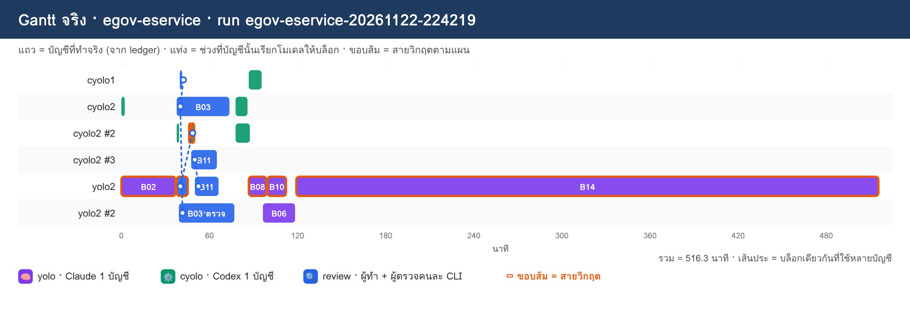
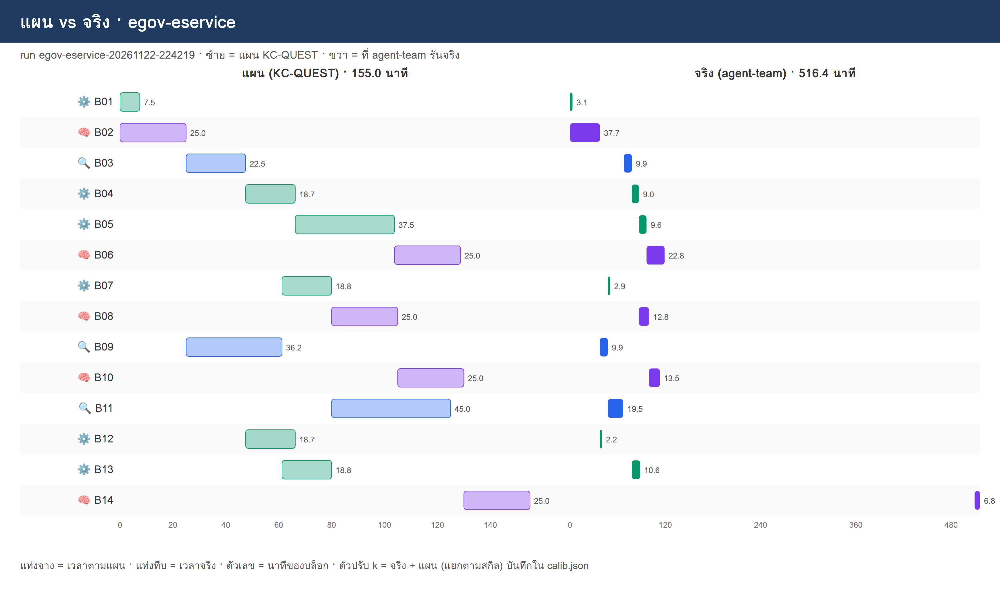

# REPORT · egov-eservice

**run:** `egov-eservice-20261122-224219` · `/workspace/.agent-team/egov-eservice-20261122-224219` · โจทย์: Continue the approved C-design municipal e-Service in app/ from completed T001-T020 to full acceptance: implement T021-T078 per REQUIREMENTS/CONTRACT/TEST-DATA/DECISIONS (sources in app/ root, read-only), Docker Compose one-command run, TEST_MODE=1, BUG_MODE per BUGS.md, and Playwright for all 51 TEST-PLAN TCs. Read app/handoffs/00-HANDOFF.md first.

## ตารางบล็อก (แผน vs จริง)

| บล็อก | สกิล | บัญชีแผน | บัญชีจริง | นาทีแผน | นาทีจริง | tokens (ไม่รวม cache read) | ครั้ง | สถานะ | ไฟล์ผล |
|---|---|---|---|---|---|---|---|---|---|
| B01 | ⚙️ cyolo | cyolo2(ทำ) | cyolo2(ทำ) | 7.50 | 3.15 | 65,179 | 1 | ok | ✅ handoffs/B01-baseline.md |
| **B02** | 🧠 yolo | yolo2(ทำ) | yolo2(ทำ) | 25.00 | 37.68 | 883 | 1 | ok | ✅ web/tests/e2e/source-helpers.ts |
| B03 | 🔍 review | cyolo1(ทำ), yolo2(ตรวจ) | cyolo2(ทำ), yolo2(ตรวจ), cyolo1(ทำ) | 22.50 | 9.90 | 343,329 | 6 | ok | ✅ web/src/server/domain/fees.ts |
| B04 | ⚙️ cyolo | cyolo1(ทำ) | cyolo2(ทำ) | 18.75 | 8.97 | 131,302 | 1 | ok | ✅ web/src/server/domain/uploads.ts |
| B05 | ⚙️ cyolo | cyolo2(ทำ) | cyolo1(ทำ) | 37.50 | 9.62 | 121,226 | 1 | ok | ✅ web/src/server/domain/payments.ts |
| B06 | 🧠 yolo | yolo2(ทำ) | yolo2(ทำ) | 25.00 | 22.75 | 367,725 | 1 | ok | ✅ web/src/server/domain/cases.ts |
| **B07** | ⚙️ cyolo | cyolo2(ทำ) | cyolo2(ทำ) | 18.75 | 2.93 | 72,880 | 1 | ok | ✅ web/src/server/domain/claims.ts |
| **B08** | 🧠 yolo | yolo2(ทำ) | yolo2(ทำ) | 25.00 | 12.78 | 273,689 | 1 | ok | ✅ web/src/server/domain/review.ts |
| **B09** | 🔍 review | yolo2(ทำ), cyolo2(ตรวจ) | yolo2(ทำ), cyolo2(ตรวจ) | 36.25 | 9.85 | 299,278 | 2 | ok | ✅ web/src/server/domain/sla.ts |
| **B10** | 🧠 yolo | yolo2(ทำ) | yolo2(ทำ) | 25.00 | 13.45 | 323,662 | 1 | ok | ✅ web/src/server/domain/approvals.ts |
| B11 | 🔍 review | cyolo1(ทำ), yolo2(ตรวจ) | cyolo2(ทำ), yolo2(ตรวจ) | 45.00 | 19.48 | 296,753 | 4 | ok | ✅ web/src/server/domain/dashboard.ts |
| B12 | ⚙️ cyolo | cyolo2(ทำ) | cyolo2(ทำ) | 18.75 | 2.25 | 71,373 | 1 | ok | ✅ web/src/server/domain/audit.ts |
| B13 | ⚙️ cyolo | cyolo1(ทำ) | cyolo2(ทำ) | 18.75 | 10.58 | 141,655 | 1 | ok | ✅ web/src/server/domain/admin.ts |
| **B14** | 🧠 yolo | yolo2(ทำ) | yolo2(ทำ) | 25.00 | 6.83 | 629,214 | 2 | ok | ✅ handoffs/B14-final-evidence.md |

- tokens รวมของบล็อก **3,138,148** = ผลรวมจาก ledger ของ run (24 การเรียก) **3,138,148** ✅ ตรงกัน
- การเรียกที่ไม่ใช่บล็อก (ตรวจความพร้อม ฯลฯ): 0 ครั้ง · 0 tokens (ไม่นับในตาราง)
- เวลารวม: แผน 155.0 นาที · จริง 516.4 นาที
- บล็อกเสร็จ 14/14

## ภาพ

## ความต่างระหว่างแผนกับของจริง

- B03: แผน cyolo1(ทำ), yolo2(ตรวจ) → จริง cyolo2(ทำ), yolo2(ตรวจ), cyolo1(ทำ)
- B04: แผน cyolo1(ทำ) → จริง cyolo2(ทำ)
- B05: แผน cyolo2(ทำ) → จริง cyolo1(ทำ)
- B11: แผน cyolo1(ทำ), yolo2(ตรวจ) → จริง cyolo2(ทำ), yolo2(ตรวจ)
- B13: แผน cyolo1(ทำ) → จริง cyolo2(ทำ)
- (export ส่งเป็นฝั่ง yolo/cyolo ไม่ผูกบัญชี เพื่อให้ failover ของ agent-team ทำงาน → agent-team เลือกบัญชีในฝั่งเองตามโหลด/โควตา ดู references/run.md)

## ตัวปรับเวลา k (calib.json)

`/workspace/plans/calib.json`: {"cyolo": 0.3125, "yolo": 0.7479, "review": 0.3781}

k = นาทีจริง ÷ นาทีแผน (ก่อนคูณ k) แยกตามสกิล · `plan` ครั้งถัดไปคูณเวลาแต่ละบล็อกด้วย k ของสกิลนั้น

## หมายเหตุจาก orchestrator (เพิ่มเอง ไม่ได้มาจาก `report`)

- **Codex เขียนแค่ไฟล์หลัก:** prompt ที่ `dagplan export` สร้างมีบรรทัด "เขียนเฉพาะ `<output>`" Codex ทำตามตรงตัว
  - B03 ล้มในรอบแรก ส่วน B07 กับ B12 ได้ ok แต่ไม่ครบ
  - แก้ด้วย `graph.fixed.json` ที่ใส่รายการไฟล์ทั้งหมดของแต่ละบล็อก แล้ว `run --resume` สำหรับ B03 และบล็อกที่ถูก block
  - เติมไฟล์ของ B07 และ B12 ผ่าน repair run `egov-eservice-repair-20261122` บน cyolo1 · tokens ของ repair run **ไม่อยู่ในตารางข้างบน** (B12fix: input 2.4M, output 17.8k)
- **B01:** เขียนแค่สูตร Compose ไว้ใน handoff · orchestrator สร้าง `compose.yaml`, `web/Dockerfile` และ `.dockerignore` ตามสูตรนั้นตามตัวอักษร · B14 build และ smoke test ผ่าน
- **ตาราง B14 นับแค่ครั้งสุดท้าย:**
  - ครั้งแรก (00:41–03:41) รวมระบบและรัน campaign แต่ timeout ที่ 10800 วินาที · campaign-2 รันต่อจนจบ 03:59 ได้ "ALL OK"
  - ครั้งที่ 2 (07:11–07:18) เป็น resume แบบเขียนหลักฐานจาก campaign-2 อย่างเดียว · ตาราง "นาทีจริง 6.83" นับเฉพาะครั้งนี้
- **เวลารวม 516 นาทีรวมช่วงที่ Docker ปิด:** ประมาณ 04:00–07:10 ระหว่างที่เครื่อง sleep หรือรีสตาร์ต · เวลาทำงานจริงประมาณ 22:42–04:00 และ 07:11–07:18
- **tokens ของ Claude ต่ำผิดปกติ:** หลายบล็อกเช่น B02 = 883 เพราะสูตร tokens ของ base skill ไม่นับ cache read ไม่ได้แปลว่าใช้โควตาน้อย
- **ผล acceptance:** ดู [B14-final-evidence.md](../../../assignments/week-02/municipal-eservice/handoffs/B14-final-evidence.md) และ [bug-hunt-runs/campaign.json](bug-hunt-runs/campaign.json) · ผลรัน 51 TC ขั้น 4 อยู่ที่ [test-report/](test-report/index.html)
  - baseline 51/51 สองรอบบน server เดียว
  - BUG_MODE B01–B12 และ mutant ผสม 2 ชุด ล้มตรงตาม BUGS.md
  - baseline สุดท้าย 51/51
  - NFR-04 ไม่พบข้อมูลที่เป็น plaintext · ทุก hook ตอบ 404 เมื่อปิด TEST_MODE
